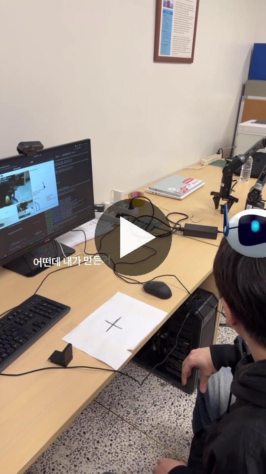
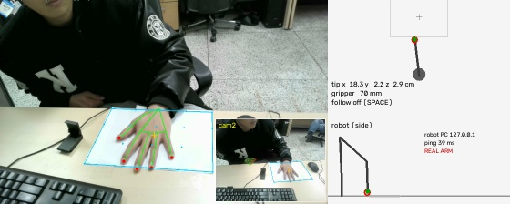
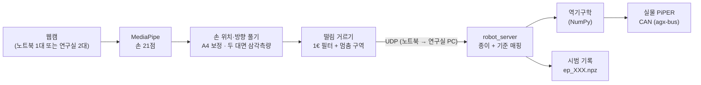
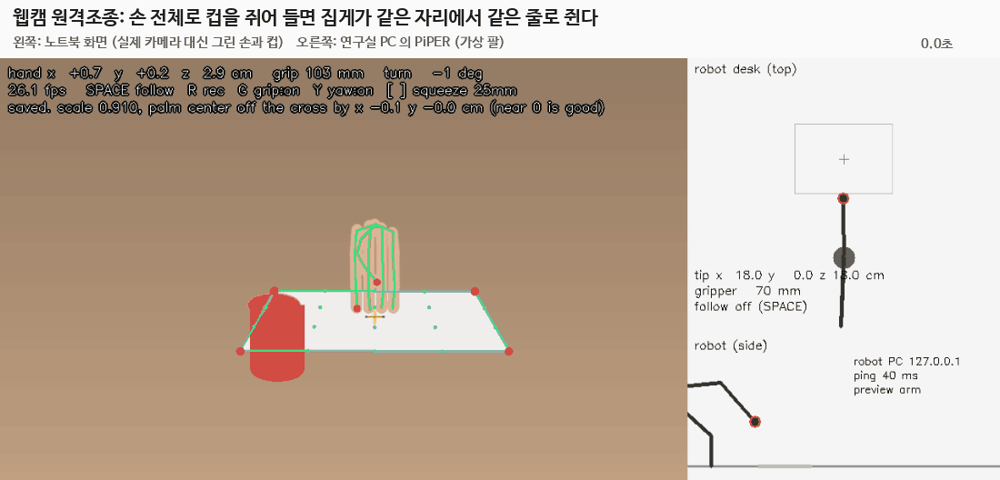

<div align="center">

# 웹캠으로 실물 PiPER 로봇팔 원격조종

[](../../기술_용어집.md#python)
[](../../기술_용어집.md#mediapipe)
[](../../기술_용어집.md#opencv)

**카메라로 사람 손을 재서, 연구실의 실물 6축 로봇팔 PiPER가 손을 따라 물체를 집게 합니다** · `2026.11` · 학부연구생 (계명대 LAB-1309)

</div>

---

로봇에게 일을 가르치려면 사람이 직접 보여 준 시범 데이터가 필요합니다. 보통은 VR 장비나 똑같은 로봇팔을
하나 더 두고 손으로 움직여서 모읍니다. 이 작업은 **웹캠과 A4 종이 한 장만으로** 그 시범을 모으려고 만들었습니다.
교수님이 제안하신 방향(사람 손 키포인트로 로봇을 가르치는 Point Policy, arXiv 2502.20391)을 따랐습니다.

<p align="center">
<a href="https://www.youtube.com/shorts/RBSCCwu8Yuc"></a>
<br>
<sub>왼쪽: 연구실 시연 영상 (그림을 누르면 유튜브 영상이 열립니다). 오른쪽: 실제 조종 화면입니다. 왼쪽 위는 카메라 1, 아래는 카메라 2가 본 손이고,
맨 오른쪽은 실물 팔(REAL ARM)의 자세입니다. 11/20 주간보고에 쓴 화면입니다.</sub>
</p>

## 규칙은 하나입니다

**사람 쪽 종이의 + 에서 손이 움직인 만큼, 로봇 쪽 종이의 + 에서 집게 끝도 똑같이 움직입니다.**
두 책상에서 각자 + 를 기준으로 같은 자리에 물체를 두면, 사람이 쥐는 자리에 집게도 갑니다.



## 05번(웹캠 로봇팔)과 달라진 점

[05. 웹캠 로봇팔 원격조종](../05.%20웹캠%20로봇팔%20원격조종/)에서 시작했습니다. 그때는 사람 팔의 관절 각도를 로봇 관절에 그대로 옮겼습니다.
이번에는 물체를 집는 것이 목적이라 방식을 바꿨습니다.

| | 05번 (2026.08) | 07번 (2026.11) |
|---|---|---|
| 로봇 | SO-ARM101 (교육용) | **PiPER (연구실 실물 6축 팔)** |
| 옮기는 것 | 사람 팔 관절 각도 → 로봇 관절 | **손이 움직인 거리 → 집게 끝 위치** (사실상 집게만 물체에 닿으면 됨) |
| 쥐기 | 손끝 사이 거리 | 손 전체로 쥐기 (엄지 ↔ 네 손가락), TAB 으로 엄지·검지로 바꿈 |
| 카메라 | 노트북 1대 | 노트북 1대, 또는 연구실 2대로 삼각측량 |
| 컴퓨터 | 한 대 | 노트북은 손만 재고, 팔은 연구실 PC 가 움직임 |
| 기록 | 없음 | 시범마다 카메라·손·팔 상태 저장 |

## 날짜별로 한 일

| 날짜 | 한 일 |
|---|---|
| 11/15 | PiPER 판 첫 버전. 손 전체로 쥐기, A4 네 모서리와 "손 펴서 올려놓기"로 보정, 가상 팔로 시험 → [일지](연구%20일지/2026-11-15.md) |
| 11/16 | 코드 검토 (첫 장면이 엉뚱할 때 그 값에 묶이던 버그, 손 3D 가 거울상으로 나오는 문제 고침). 노트북에서 Claude 가 따라 할 실행 안내 작성. **실물 팔 첫 시험** |
| 11/17 | 손 모양 바꾸기(TAB), 노트북이 켤 때 새 코드를 스스로 받기, 웹캠 스탠드 3D 프린팅 파일, VR 컨트롤러 조종 시도 (11/18 보류) |
| 11/18 | 실물에서 손 높이가 책상 아래로 튀던 문제를 고침 (손 위치 푸는 방식을 OAT 로). 필터 늦음 70 → 15 ms. **카메라 두 대 삼각측량** |
| 11/19 | 손끝 높이 맞추기(Z), 종이 밖까지 움직이게 작업 범위 넓힘. 웹캠 두 대로 실물 조종 시험 (주간보고) |
| 11/20 | **처음 자세 버튼(B)** 실물 시험 통과, 떨림 거르기, 바탕화면 아이콘 하나로 켜기 → [일지](연구%20일지/2026-11-20.md) |

## 잰 결과

**실물 팔**

| 날짜 | 확인한 것 | 결과 |
|---|---|---|
| 11/16 | 노트북 카메라 손으로 실물 팔 따라가기 80초 (천천히) | 집게 끝이 목표와 0.7 cm, 그리퍼가 28~69 mm 움직임 |
| 11/20 | 처음 자세 B (가짜 손으로 앞 25 cm·책상 위 10 cm 로 옮긴 뒤) | 25.2 cm·10.5 cm 에 도착, B 로 1.75초 만에 돌아와 저장한 자세와 관절 차 0.2° 안 |

**가상 시험** (그린 손과 가상 팔, `test_geometry.py` 24개 모두 통과)

| 확인한 것 | 결과 |
|---|---|
| 역기구학 (종이 전체, 높이 1~15 cm, 집게 돌림 ±60°) | 588곳 모두 5 mm 안 |
| 손 크기 맞추기 (MediaPipe 가 손 크기를 10% 틀리게 알 때) | 0.913 으로 맞춤 (참값 0.909) |
| 손 3D 가 거울상인지 알아채기 (20장 다수결) | 120번 중 119번 맞음 |
| 떨림 거르기 (11/19 → 11/20) | 멈춰 있을 때 흔들림 3.4 → 1.3 mm, 크게 튀는 폭 19.5 → 4.7 mm, 대신 25 ms 늦어짐 |

<p align="center"><br>
<sub><b>가상 시험 화면입니다. 실제 촬영이 아닙니다.</b> 왼쪽은 그린 손과 컵으로 돌린 노트북 화면, 오른쪽은 연구실 PC 쪽 가상 PiPER 입니다.
손이 컵을 쥐고 드는 동안 집게 끝이 로봇 종이의 같은 자리에서 같은 줄로 쥡니다.</sub></p>

**아직 하지 않은 것**
- 진짜 손과 카메라로 잰 위치 오차, 손을 움직인 뒤 팔이 따라오기까지의 지연은 측정해 보지 않았습니다. 그린 손 시험의 0.2~0.3 cm 는 MediaPipe 손 모양이 정확할 때 이야기이고, 실제로는 1~4 cm 까지 커질 수 있습니다.
- 실물로 시범을 여러 개 모으는 일, 모은 기록을 연구실 학습 형식(zarr)으로 바꾸는 변환기는 다음 단계입니다.

## 안전하게 하려고 넣은 것

- 처음 몇 번은 집게가 손보다 10 cm 위에서, 천천히 따라가게 켭니다.
- 노트북 신호가 0.5초 끊기면 팔이 그 자리에 멈춥니다. 다시 움직이려면 사람이 SPACE 를 눌러야 합니다.
- 팔 둘레를 비우고 전원 스위치 옆에 사람이 선 다음에만 켭니다 (켤 때 안전 안내에 Enter).
- 처음 자세로 돌아가는 길에 팔 마디가 책상 아래로 내려가면 움직이지 않습니다.

## 폴더

```
07. 학부연구생 - 웹캠 PiPER 원격조종
├── README.md            ← 이 글
├── assets/              ← 시연 영상 첫 장면, 실제 조종 화면
├── 연구 일지/            ← 11/15, 11/20 연구 일지
└── webcam_piper/        ← 코드와 설명서
    ├── 사용설명서.md      ← 그림이 있는 자세한 설명서
    ├── 노트북_실행.md     ← 노트북의 Claude 가 그대로 따라 하는 실행 안내
    ├── teleop.py         ← 카메라로 손 재기 (노트북 또는 연구실 PC)
    ├── robot_server.py   ← 손 → 집게 끝 매핑, 역기구학, 실물 팔, 기록 (연구실 PC)
    ├── piper_kin.py      ← PiPER 역기구학 (NumPy 만 씀)
    └── stand/            ← 웹캠 스탠드 3D 프린팅 파일
```

코드는 연구실 공개 저장소 [LAB-1309 `11_실물_PiPER/webcam_piper`](https://github.com/kakabab12/LAB-1309/tree/main/11_실물_PiPER/webcam_piper)에서
11/23 에 가져온 것입니다. 계속 고치는 중이라 최신 코드와 매일의 연구 일지는 그쪽에 있습니다.
