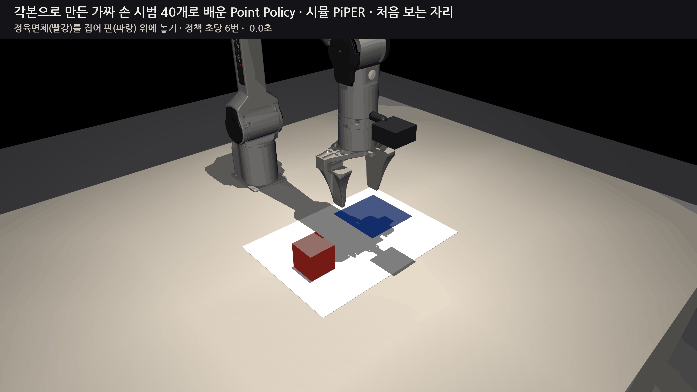
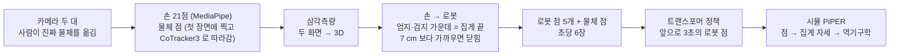

# 사람 손 시범으로 PiPER 가르치기 (Point Policy 방식)

> 교수님이 말씀하신 논문 **Point Policy** (Haldar·Pinto, 뉴욕대, [arXiv 2502.20391](https://arxiv.org/abs/2502.20391))를 PiPER 에 맞춘 것이다.
> 사람이 진짜 물체를 손으로 옮기는 모습을 카메라 두 대로 찍고, 영상에서 뽑은 **점 몇 개만으로** 로봇 정책을 학습한다.
> 로봇은 시뮬레이터 PiPER 를 쓴다. MediaPipe 실시간 조종([webcam_piper](../webcam_piper/README.md))은 그대로 두고 따로 만들었다.

<p align="center"><br>
<sub>각본으로 만든 가짜 손 시범 40개로 배운 정책이, 학습 때 없던 자리의 정육면체를 집어 판 위에 놓는 장면 (시뮬, 4K). 진짜 손 시범은 아직 모으지 않았다.</sub></p>

## 지금 어디까지 왔나 (2026-11-27)

| 확인한 것 | 결과 | 조건 |
|---|---|---|
| 손 → 로봇 궤적을 시뮬에서 그대로 재생 | 40개 중 40개 성공 | 가짜 손 시범 40개 (각본, 카메라 두 대 화면에 3 px 잡음) |
| 학습한 정책을 처음 보는 자리에서 | **50장면 중 47개 성공 (94%)** | 같은 가짜 시범 40개로 학습, 물체 점은 참값 + 1 px 잡음 |
| 같은 정책을 placo 역기구학으로 실행 | 50장면 중 47개 (94%) | 위와 같은 장면 50개 |
| placo 로 만든 자료로 다시 학습, placo 로 실행 | 50장면 중 47개 (94%) | 실패 3장면이 위와 같음 |
| 물체 점을 영상에서 따라간 것(CoTracker3)으로 학습 | 50장면 중 46개 (92%) | 같은 시범을 두 카메라 시뮬 영상으로 그려, 첫 점만 찍고(참값 + 1.5 px) 따라감 |
| 물체 점 따라가기 (CoTracker3) | 시범마다 가운데값의 가운데: 정육면체 7.0 mm, 판 4.7 mm. 40개 중 14개는 판이 가려질 때 한때 5 cm 넘게 튐 | 시뮬로 그린 두 카메라 영상 40개, 첫 점은 직접 찍은 것처럼 |
| 첫 점을 다른 시범으로 저절로 옮기기 (DINOv2) | 정육면체 4~15 mm, 판 5~25 mm, 판이 9~11 cm 빗나간 시범 2개 | 같은 영상 6개. 무늬 없는 판에서 약함 |
| 진짜 손 녹화 → 학습 | **아직 안 함** | 녹화 프로그램은 가짜 카메라로 저장만 확인 |

숫자는 모두 시뮬과 가짜 시범에서 나온 것이다. 진짜 손 영상에서 얼마나 되는지는 측정해 보지 않았다.

## 어떻게 움직이나



1. **녹화**: 사람이 정육면체를 집어 판 위에 놓는 모습을 카메라 두 대로 찍는다. 로봇은 움직이지 않는다.
2. **손 점**: 영상마다 MediaPipe 로 손 21점을 찾는다 (논문도 손은 MediaPipe 로 엄지·검지 끝을 찾는다).
3. **물체 점**: 첫 장면에 정육면체 윗면 가운데와 판 가운데를 찍으면, CoTracker3 가 영상 끝까지 따라간다.
4. **3D**: 두 화면의 같은 점을 삼각측량해 3D 위치를 얻는다. 카메라 보정은 webcam_piper 와 같은 A4 종이다.
5. **손 → 로봇**: 엄지 끝과 검지 끝의 가운데가 집게 끝, 손바닥이 돈 만큼 집게도 돌고, 엄지·검지가 7 cm 보다 가까우면 집게를 닫는다.
6. **로봇 점**: 집게 자세에 붙은 점 5개로 바꾼다. 사람 손과 로봇 집게는 생김새가 달라도, 점으로 바꾸면 같은 말이 된다.
7. **학습**: 점 하나가 토큰 하나인 트랜스포머가, 지난 10걸음(1.7초)을 보고 앞으로 20걸음(3.3초)의 로봇 점과 집게를 낸다.
8. **시뮬에서 실행**: 낸 점에 집게 모양을 맞춰 자세를 되찾고, 역기구학으로 관절을 풀어 시뮬 PiPER 를 움직인다.

## 논문과 같은 것, 다른 것

| | 논문 (Franka) | 여기 (PiPER) |
|---|---|---|
| 손 점 | MediaPipe 엄지·검지 끝, 카메라 2대 삼각측량 | 같음 (21점을 다 남겨 손바닥으로 회전을 잼) |
| 물체 점 | 사람이 한 번 찍고 DIFT 로 옮김, CoTracker 로 따라감 | CoTracker3 같음. DIFT 는 Stable Diffusion 2.1 공식판이 내려가서 DINOv2 로 바꿈 |
| 집게 | 엄지·검지 7 cm 기준 | 같음 |
| 정책 | BAKU 트랜스포머, 지난 10걸음, 앞으로 20걸음, 초당 6번 | 같은 구조를 직접 짬 (4층, 256) |
| 로봇 | 실물 Franka (7축) | 시뮬 PiPER (6축). 집게를 똑바로 아래로 세우면 책상 위 11 cm 까지만 닿아서, 손에서 나온 자세를 역기구학으로 풀어 PiPER 가 할 수 있는 자세로 바꾼 뒤 로봇 점을 만든다 |
| 물체 | 실물 | 시뮬에서는 참값 물체 점을 씀 (정육면체·판 크기를 진짜와 맞춰야 함) |

## 쓰는 법

연구실 PC 에서 `~/smolVLA` 폴더 기준이다. 가상환경이 셋이다.

| 가상환경 | 쓰는 곳 |
|---|---|
| `webcam_piper/.venv` (Python 3.12, MediaPipe, 창 띄우기) | 녹화, 손 점, 물체 점 찍기 |
| `.venv` (Python 3.10, torch, mujoco) | 물체 점 따라가기, 학습, 시뮬 평가 |
| `point_policy/.venv` (위 `.venv` + placo) | 위와 같고, `--ik placo` 를 쓸 때 |

**0. 카메라 두 대와 A4 종이**

APC930 카메라 두 대를 높은 기둥([../webcam_piper/stand_high](../webcam_piper/stand_high/README.md), 책상 위 80 cm, 55° 아래)에 달고, 둘이 60~90° 벌어지게 놓는다.
A4 종이를 책상에 가로로 놓는다. 보정은 webcam_piper 와 같다 (`webcam_piper/calib.json` 을 불러오고, 없으면 종이를 저절로 찾음).

**1. 녹화** (시범마다 정육면체·판 자리를 바꿔서 30개쯤)

```bash
webcam_piper/.venv/bin/python point_policy/record.py --cam 0 --cam2 2
```

오른손을 종이 + 위 10 cm 에 두고(손등 위, 엄지·검지 벌림) 왼손으로 SPACE, 정육면체를 판 위에 놓고 SPACE. D 두 번은 방금 시범 지우기.
옆에서 시뮬 PiPER 가 손을 따라 움직이는 것을 보려면 다른 창에서 `.venv/bin/python point_policy/mirror.py` 를 먼저 켜고 `--mirror 127.0.0.1:5011` 을 붙인다.

**2~4. 손 점, 물체 점 찍기, 따라가기**

```bash
webcam_piper/.venv/bin/python point_policy/hand_points.py point_policy/data/cube_to_pad/real
webcam_piper/.venv/bin/python point_policy/annotate.py point_policy/data/cube_to_pad/real
.venv/bin/python point_policy/object_points.py point_policy/data/cube_to_pad/real
```

`annotate.py` 는 첫 시범 첫 장면에 점을 찍는다 (카메라마다 정육면체 윗면 가운데, 판 가운데). 다른 시범은 저절로 옮겨 찍는데,
무늬 없는 물체에서는 빗나갈 수 있어서 `--ep ep_003` 처럼 시범마다 직접 찍는 것을 권한다 (시범 하나에 클릭 네 번).

**5~7. 학습 자료, 재생 검사, 학습, 평가**

```bash
.venv/bin/python point_policy/build_dataset.py point_policy/data/cube_to_pad/real
.venv/bin/python point_policy/replay_sim.py point_policy/data/cube_to_pad/real/dataset.npz
.venv/bin/python point_policy/train.py point_policy/data/cube_to_pad/real/dataset.npz --out point_policy/runs/real
.venv/bin/python point_policy/sim_eval.py point_policy/runs/real/policy.pt --n 50 --gif-dir point_policy/runs/real/gifs --gifs 3
```

`replay_sim.py` 는 학습 없이 사람 시범 궤적을 시뮬 PiPER 로 그대로 재생한다. 여기서 실패하는 시범은 손 → 로봇 바꾸기가 맞지 않는 것이라 빼는 게 낫다.

카메라 없이 전체 길을 시험하려면 `synth_demos.py` (각본으로 가짜 손 시범) 와 `render_synth_video.py` (가짜 시범을 두 카메라 영상으로) 를 쓴다.

## placo 역기구학

[placo](https://github.com/Rhoban/placo) 는 찬혁님 VR 조종에서 쓰는 역기구학이다. 관절 한계와 속도 한계를 꼭 지킬 조건으로 넣고,
집게 끝 위치·방향을 무게를 준 바람으로 넣어 이차 계획(QP)으로 푼다. `--ik placo` 로 켠다 (`point_policy/.venv` 필요).

| 역기구학 | 위치 오차 가운데 / 최대 | 1 cm 넘게 틀린 목표 | 방향 오차 가운데 | 한 번 푸는 시간 |
|---|---|---|---|---|
| numpy (webcam_piper, 위치 먼저) | 0.03 / 180 mm | 240개 중 2개 | 21° | 21 ms |
| placo, 방향 무게 0.01 (찬혁님 값) | 3.9 / 317 mm | 61개 | 6.3° | 1.1 ms |
| **placo, 방향 무게 0.001 (기본)** | 0.85 / 3.1 mm | 0개 | 11.5° | 1.1 ms |

목표 240개: 책상 위 0.5~16 cm, 집게를 아래로 또는 25° 기울여서. placo 에는 시뮬 모델에서 만든 URDF 를 넣었다 (`placo_model/piper_sim.urdf`, 시뮬과 3.5e-13 m 까지 같음).
찬혁님 URDF (AgileX) 는 우리 시뮬 모델과 같은 관절 각도에서 집게 끝이 가운데값 7 mm, 최대 15 mm 달라서 그대로 쓰지 않았다. 실물로 옮길 때 알아 둘 차이다.
자기 몸과 부딪히지 않게 하는 조건은 아직 넣지 않았다.

## 파일

| 파일 | 하는 일 |
|---|---|
| `task_cube.json` | 작업 설정: 정육면체·판 크기, 놓는 범위, 물체 점, 7 cm 기준, 초당 6장 |
| `record.py` | 카메라 두 대 녹화 (MJPG, 초당 30장) |
| `mirror.py` | 녹화하는 동안 시뮬 PiPER 가 손을 따라 움직이는 창 |
| `hand_points.py` | 영상 → 손 21점 |
| `annotate.py` | 첫 장면에 물체 점 찍기 |
| `object_points.py` | 첫 점 옮기기 (DINOv2) + 따라가기 (CoTracker3) |
| `points.py` | 손 → 로봇 자세, 로봇 점 5개, 점 → 자세 (Kabsch) |
| `build_dataset.py` | 삼각측량, 손 → 로봇, 역기구학, 초당 6장 |
| `model.py`, `train.py` | 트랜스포머 정책과 학습 |
| `sim_scene.py` | 시뮬 장면 (PiPER, 책상, 정육면체, 판) |
| `sim_eval.py`, `replay_sim.py`, `make_gif.py` | 시뮬 평가, 시범 재생, GIF |
| `placo_ik.py` | placo 역기구학과 URDF 만들기 (`python placo_ik.py` 로 시험) |
| `synth_demos.py`, `render_synth_video.py` | 카메라 없이 시험하는 가짜 시범과 가짜 영상 |

## 아직 하지 않은 것

- 진짜 손으로 시범을 모으는 일. 녹화·손 점 프로그램은 진짜 카메라와 손으로는 돌려 보지 않았다.
- 실물 PiPER 로 옮기기. 그때는 물체 점을 진짜 카메라와 CoTracker3 로 재야 하고, 시뮬 모델과 실물의 차이(위 placo 절)를 다시 재야 한다.
- 물체 여러 개, 다른 작업. 지금은 정육면체 하나를 판 하나 위에 놓는 일만 있다.
