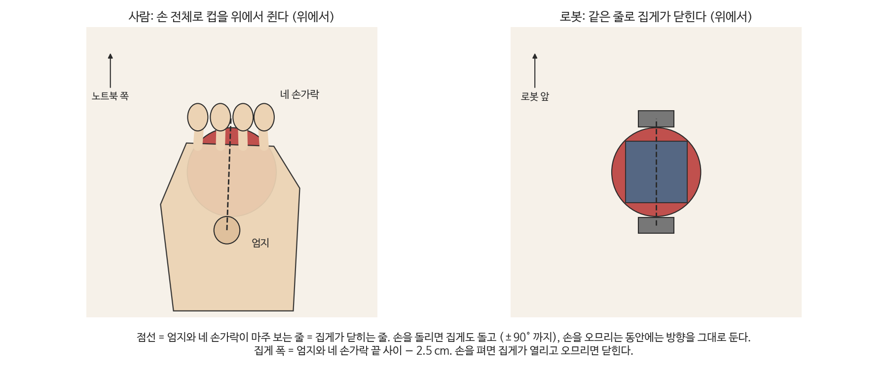

# 웹캠 하나로 PiPER 원격조종 (webcam_piper)

My_portfolio `2026/05. 웹캠 로봇팔 원격조종` (SO-ARM101, LeRobot) 을 연구실 **PiPER** 용으로 바꾼 것이다. 2026-11-15.

> 처음 쓰는 사람은 [사용설명서.md](사용설명서.md) 부터 본다 (책상 놓기, 보정, 연구실 PC 연결, 실물 기록 순서, 문제 해결).
> 노트북의 Claude 에 맡길 때는 [노트북_실행.md](노트북_실행.md) 링크를 준다 (받기, 설치, 점검, 켜기, 결과 정리 순서).
> 웹캠 대신 Quest 컨트롤러만 들고 조종하려면 [VR_손잡이.md](VR_손잡이.md) (11/17, 헤드셋은 머리에 쓰지 않고 옆에 세워 둠, 종이 + 기준은 같음).
>
> **11/18 오후: 노트북 없이 연구실 PC 에 카메라 두 대 (ABKO APC930)** — 교수님 논문 Point Policy (Haldar·Pinto, arXiv 2502.20391) 처럼
> 고정 카메라 두 대의 MediaPipe 손 21점을 삼각측량(DLT)해 3D 를 바로 얻는다 (손 크기 가정 없음). 보정은 저절로: 두 카메라가 A4 를 찾고, 손을 + 위에 펴서 1초.
> 1. 카메라 자리 맞추기: `.venv/bin/python cam_check.py` (두 화면에 종이가 파란 테두리로 잡히면 됨, Q 로 끝)
> 2. 받는 쪽: `~/smolVLA/chanhyuk_piper-teleop/.venv/bin/python robot_server.py` (가상 팔. 실물은 `--robot agxbus --speed 30 --lift 0.10 --max-speed 0.3`)
> 3. 손 재기: `.venv/bin/python teleop.py --cam 0 --cam2 2 --send 127.0.0.1` (이 PC 의 `.venv` = Python 3.12 + MediaPipe 1.2.3, uv 로 만듦)
> 카메라 두 대 모두 사람 맞은편(모니터 위 등)에서 종이를 비스듬히 내려다보게, 두 방향이 60~90° 벌어지게. MJPG 로 받아야 초당 30장 (압축 안 하면 1280x720 에서 10장).
> 기록(robot_server)에는 `src` (2 삼각측량, 1 한 대), `tri3d` (삼각측량 21점, 사람 책상 좌표), `lm2d_b` (두 번째 화면 21점) 가 더 남는다.
>
> **11/20 더한 것**
> - **처음 자세 버튼 (B)**: 팔을 교시 모드(손으로 끌기)로 원하는 자세에 두고 `.venv/bin/python save_home.py` → `home_pose.json` 에 저장 (CAN 을 듣기만 해서 팔은 안 움직임, `--show` 는 보기만).
>   robot_server 가 도는 동안 teleop 에서 **B** (또는 robot_server 창 B) 를 누르면 따라가기가 꺼지고 그 관절 자세로 부드럽게 돌아간다 (최소 저크, 가장 많이 도는 관절 최고 0.6 rad/s `--home-rate`, 그리퍼는 그대로).
>   가는 중 SPACE = 그 자리에 멈춤. 가는 길에 팔 마디가 책상 아래 1 cm 넘게 내려가면(가상 팔 모델로 계산) 움직이지 않는다. 교시 모드인 동안 팔은 명령을 안 받으니 robot_server 켜기 전에 교시 모드를 끈다.
>   11/20 저장한 자세: 관절 −2.9, 81.4, −23.1, 6.2, 38.7, −7.5 도 (집게 끝 밑동 앞 14.8 cm, 책상 위 약 1 cm).
>   실물 시험 (`real_home_test.py`, 가짜 손으로 앞 25 cm·책상 위 10 cm 로 옮긴 뒤 B): 도착 25.2 cm·10.5 cm, B 로 1.75초에 돌아와 처음 자세와 관절 차 0.2° 안.
>   교시 모드를 버튼으로 꺼도 팔은 '교시' 로 남아 있었고, 전원을 껐다 켜니 대기 → robot_server 가 CAN 명령 모드로 바꿈.
> - **종이 + = 처음 자세 집게 끝** (robot_server): 손을 + 에, 집게를 처음 자세에 두고 SPACE 를 눌렀더니 팔이 앞으로 15 cm 갔다. 종이 + 를 밑동 앞 30 cm 로 잡고 있었기 때문 (처음 자세 집게 끝은 14.8 cm).
>   이제 `home_pose.json` 이 있으면 + 를 처음 자세 집게 끝(앞·옆·높이)에 맞춘다 (`--x0`/`--y0` 를 주면 예전처럼 그 자리). 가상 팔: 손 + → 0.1 cm 움직임, 손 10 cm 위/앞 → 집게도 10 cm 위/앞.
>   처음 자세가 밑동 가까이(앞 14.8 cm)라 밑동 쪽으로는 2.8 cm 만 간다 (작업 상자 앞최소 12 cm). 종이를 더 넓게 쓰려면 처음 자세를 더 앞에 저장한다.
> - **바탕화면 아이콘 'PiPER 조종'** (`start_piper.sh`): 창 두 개 — 'PiPER 서버' (CAN 꺼져 있으면 sudo 로 켜기, 팔이 교시 모드면 기다림, 이미 켜져 있으면 안 켬, 안전 안내 Enter 는 사람이)
>   와 'PiPER 카메라' (서버가 켜지면 teleop `--cam 0 --cam2 2`). 서버 설정은 11/19 실물 따라가기와 같고 LIFT 만 0 (11/19 는 `--lift 0.10`, 스크립트 맨 위 LIFT 로 바꿈).
> - **지터·손떨림 거르기** (teleop, 기본 켬, `--no-steady` 로 끔): 손이 멈춰 있을 때(초당 5 cm 아래)만 앞 3장면 가운데 값을 써서 한 장면 튐을 버리고, 1€ 필터 뒤에 **멈춤 구역**(반지름 3 mm, `--still-mm`)을 둔다.
>   손이 그 안에서 떨리면 목표를 그대로 두고, 밖으로 나가면 넘은 만큼만 끌려간다 (멈추면 0.4초에 걸쳐 가운데로 맞춤). 집게 방향도 3° 구역.
> - **패킷 사이 잇기** (robot_server, 기본 켬, `--no-interp` 로 끔): 손 값은 초당 ~23번 오는데 팔 명령은 100번이라, 새 값이 올 때마다 최고 속도로 갔다 서기를 되풀이했다. 이제 새 값까지 평균 패킷 간격 동안 곧게 간다.
> - 가상 손 비교 (손떨림 9 Hz 1 mm + 느린 흔들림 1.5 mm + 잡음 xy 2·z 5 mm + 1% 장면 3 cm 튐, 23 fps, 6번 평균. 진짜 손·카메라로는 아직 측정해 보지 않았다):
>
>   | | 멈춤 흔들림 (표준편차) | 가장 크게 튈 때 폭 | 늦음 | 목표 가속도 거칠기 |
>   |---|---|---|---|---|
>   | 11/19 (1€ 만, 바로 감) | 3.4 mm | 19.5 mm | 55 ms | 38 m/s² |
>   | 11/20 (가운데 값 + 1€ + 멈춤 구역, 잇기) | 1.3 mm | 4.7 mm | 80 ms | 12 m/s² |
>
>   잡음 두 배, 초당 16장, 튐 3% 에서도 셋 다 11/19 보다 나음. 대신 25 ms 늦고, 움직이는 중에는 멈춤 구역만큼(3 mm) 뒤에서 따라온다.
>
> **11/19 더한 것**
> - 손 닿는 높이 맞추기 (Z 키): 엄지·손가락 끝을 종이에 대고 Z → 그 높이(가짜 손 시험 2.9 cm)를 0 으로. 손끝이 책상에 닿을 때 그리퍼 끝도 책상 높이로 간다.
>   서버는 `--lift` 없이 켤 것. 책상을 누르지 않게 `--min-z` 바닥(기본 0.6 cm)은 남는다. 실물 처음은 `--min-z 0.02` 로 틈을 본 뒤 낮춘다. 값은 `calib.json` 의 `hand_touch_z`
> - 종이 밖까지 (작업 상자 넓힘): robot_server 기본 앞 12~50 cm, 좌우 ±40 cm, 높이 30 cm (`--box-x`, `--box-y`, `--max-z`, 11/18 까지 앞 14~50, 좌우 ±25, 높이 25).
>   두 카메라가 같이 보는 곳은 책상 위 약 1 m² (종이 + 기준 좌우 −68~+80 cm, 카메라 쪽 +22 cm) 라 카메라는 그대로 둬도 됨 (화각 가로 62~64°, 렌즈 고정).
>   가상 팔로 따라가 보기: 종이 밖 좌우 38 cm, 앞 20 cm, 뒤 18 cm, 높이 28 cm 모두 닿음 (높이 20 cm 넘으면 집게가 16~30° 기울어짐 — PiPER 손목 구조), 팔 길이 끝(밑동 54 cm)은 1~2 cm 모자람
>
> **11/18 바뀐 것** (11/16 실물에서 손 높이가 책상 아래로 나오고 팔이 손보다 한참 느렸던 것을 고침)
> - 손 위치 푸는 기본 방식을 `oat` (손 방향은 MediaPipe 것을 쓰고 위치만 풂, OAT 논문) 로. 쥘 때 손가락 모양이 틀리게 나오면 예전 `pnp` 는 그 틀림이 카메라 쪽 거리로 커져 높이가 책상 아래로 나왔다. 노트북은 **S 로 손 보정만 다시** 한다.
> - 1€ 필터를 m 단위에 맞춤 (예전 값은 라디안용이라 빨리 움직이면 70 ms 늦었음 → 15 ms).
> - 연구실 PC `robot_server.py` 기본값을 사람 손 빠르기로: 집게 끝 1 m/s, 관절 3 rad/s, 100 Hz. 실물 첫 시험은 `--lift 0.10` (집게가 손보다 10 cm 위에서 따라감).

## 원래 코드와 달라진 점

| | 원래 (SO-ARM101) | 이번 (PiPER) |
|---|---|---|
| 무엇을 옮기나 | 사람 팔 **관절 각도**를 로봇 관절에 그대로 | 사람 **엄지 끝과 네 손가락 끝 사이 가운데(집기점)의 위치**를 로봇 **집게 끝**에 그대로. 엄지 ↔ 네 손가락 줄 = 집게가 닫히는 줄 |
| 왜 | 팔꿈치 90° → 로봇도 90° | PiPER 는 팔 길이가 사람과 달라, 각도가 같아도 집게가 엉뚱한 곳에 간다. **집게만 물체에 가면 되므로** 위치를 옮기고 관절은 역기구학이 푼다 |
| 카메라 | 사람 상체를 정면으로 | 책상 위 손과 A4 종이를 비스듬히 내려다봄 |
| 보는 것 | 몸(Pose) + 손 | 손(Hand) 하나 |

규칙은 하나다. **사람 손이 시작 표시에서 움직인 만큼, 로봇 집게 끝도 로봇 시작 표시에서 똑같이 움직인다** (1 cm → 1 cm).
그래서 두 책상에 같은 물체를 각자 시작 표시에서 같은 거리·같은 방향에 두면, 사람이 물체를 집을 때 집게도 같은 물체를 집는다.

사람은 컵을 위에서 쥐듯 **손 전체로** 쥔다 (11/16 사용자 요청으로 엄지·검지에서 바꿈). 엄지가 집게 한쪽, 네 손가락이 다른 쪽이다.
집게 폭 = 엄지와 네 손가락 끝 사이 − 25 mm. 손을 오므리는 동안(사이 < 5 cm)에는 집게 방향을 새로 읽지 않는다.
집게 방향은 따라가기를 켤 때 오른손이 잘 도는 쪽을 고르고, 6번 관절 끝(팔 방향 ±112°)에 닿으면 반 바퀴 돌지 않고 멈춘다.
작은 물체는 엄지·검지만 쓴다. 프로그램을 켠 채 TAB (또는 H) 한 번으로 바꾼다 (11/17). 처음 모양은 `--grip pinch` 로도 정한다.



## 책상 놓는 법

**사람 쪽 (노트북)**
```
 [노트북] ── 60~70 cm ──> [A4 종이]        🙋 사람
 화면을 세우고 살짝 앞으로 숙여        가로로 놓고, 한가운데에 연필로 +
 종이 네 모서리가 다 보이게           (가운데 = 왼쪽에서 148 mm, 앞에서 105 mm)
```
- 노트북은 책상 위 그대로, 사람과 마주 보게. 종이는 사람과 노트북 사이.
- 카메라 앱으로 확인: 종이 네 모서리가 다 보이고, 종이 위 20 cm 까지 손을 들어도 화면 안에 있을 것.
- 사람 뒤에 창문(역광)이 없게.

**로봇 쪽**
- 로봇 책상에도 A4 를 가로로, **종이 한가운데가 로봇 밑동 가운데에서 앞으로 30 cm** 에 오게 놓는다 (`--x0` 로 바꿀 수 있음).
- 같은 물체를 두 종이 위 **같은 자리**에 둔다. 예: 둘 다 + 에서 앞으로 8 cm, 왼쪽으로 6 cm.
- 앞·뒤·왼쪽·오른쪽은 **각자 자기 자리에서** 본 방향이다 (사람은 앉은 자리, 로봇은 밑동에서 앞을 본 방향).

**보정 자세 (사람)**: 오른손을 종이 위에 쫙 펴서 올려놓는다. 손바닥 가운데는 + 위, 손가락은 노트북 쪽 (11/16, 그림: [img/시작_자세.png](img/시작_자세.png)).
손 21점이 종이 바로 위(살 두께의 절반쯤, `geometry.FLAT_H` 어림값)에 있다는 것으로 MediaPipe 손 크기를 맞춘다. 로봇 쪽은 보정이 없다.

## 설치 (노트북)

Python 3.10~3.12. (mujoco 는 필요 없다. 로봇 계산은 numpy 로 한다.)
```bash
pip install -r requirements.txt
```
```bash
python download_models.py
```
한 번 깔면 코드를 다시 받을 일이 없다. `teleop.py`·`check_setup.py` 가 켤 때마다 GitHub 새 코드를 스스로 받고 다시 켠다 (`autoupdate.py`). 끄려면 `--no-update`.

점검은 `python check_setup.py` 하나로 한다 (프로그램, 손 모델, 계산 시험, 웹캠. 마지막 줄 `점검: 모두 됨`).
11/16 에 새 가상환경에서 Python 3.12 + MediaPipe 1.2.3 + OpenCV 5.0, Python 3.12 + MediaPipe 0.10.21 + OpenCV 4.11 둘 다 시험해서 됐다. MediaPipe 1.x 는 인텔 맥 판이 없어서 인텔 맥은 Python 3.12 이하로 0.10.x 를 쓴다.

연구실 PC 는 따로 깔 것이 없다. 찬혁님 piper-teleop `.venv` 에 numpy·opencv·agx-bus 가 다 있다 (아래 "나눠서 돌리기").

## 실행

```bash
python teleop.py
```
처음에는 팔 없이 **오른쪽 그림(가상 PiPER)** 만 움직인다.

1. **보정 1/2 — 종이 모서리.** 화면에서 종이 모서리를 순서대로 누른다. 순서는 **내 자리에서 본** 내 쪽-왼쪽 → 내 쪽-오른쪽 → 먼 쪽-오른쪽 → 먼 쪽-왼쪽.
   (화면은 거울처럼 보여 준다.) 파란 점이 종이 위에 고르게 앉으면 Enter, 아니면 Backspace.
2. **보정 2/2 — 손 펴서 올려놓기.** 위 보정 자세로 가만히 S (화면 왼쪽 아래에 그림이 뜬다). 20장을 재서 저장한다 (`calib.json`).
   "palm center off the cross by x .. y .. cm" 가 0 에 가까울수록 좋다.
3. **확인.** 다섯 손가락 끝을 모아 종이 모서리에 대 보고 화면 왼쪽 위 `hand x y` 를 읽는다. 모서리는 x ±10.5, y ±14.9 cm 여야 한다.
   몇 cm 넘게 틀리면 C 로 모서리부터 다시. 손가락 끝을 댄 채 P 를 누르면 가장 가까운 모서리(또는 +)와의 차이를 띄우고 `checks.jsonl` 에 남긴다.
   끈 뒤 `python check_setup.py --report` 가 보정 값과 P 결과를 한 덩어리로 정리한다.
4. **SPACE** 를 누르면 가상 팔이 손을 따라온다 (빨간 동그라미 = 목표, 초록 점 = 집게 끝). 다시 SPACE 면 멈춤.
5. **R** 로 기록 시작/끝 → `data/날짜_시각/ep_000.npz`. X 는 마지막 기록 지우기.

카메라나 노트북 위치를 바꾸면 `calib.json` 이 맞지 않으니 C 로 다시 보정한다.

### 키

| 키 | 하는 일 |
|---|---|
| SPACE | 따라가기 켜기/끄기 (손을 1초 넘게 놓치면 저절로 꺼짐) |
| R / X | 기록 시작·끝 / 마지막 기록 지우기 |
| G | 집게 따라가기 켜기/끄기 (끄면 열린 채) |
| Y | 집게 돌림 따라가기 켜기/끄기 (끄면 그 방향 그대로) |
| [ / ] | 집게를 5 mm 더 약하게 / 세게 쥠 (집게 폭 = 엄지와 맞은편 손가락 사이 − 이 값, 기본 25 mm, pinch 20 mm, 손 모양마다 따로 기억) |
| B | 처음 자세로 (11/20, robot_server 와 쓸 때). `save_home.py` 로 저장한 관절 자세로 부드럽게 감, 가는 중 SPACE = 멈춤 |
| TAB (또는 H) | 손 모양 바꾸기: 손 전체 ↔ 엄지·검지. 쥐는 점이 옮겨 가므로 따라가기 중이면 멈춤 → SPACE 로 다시. 화면 빨간 점이 지금 쓰는 손가락 끝 |
| C / S | 종이 모서리 다시 / 손 펴서 올려놓기 다시 |
| P | 위치 확인 (가장 가까운 모서리·+ 와의 차이, `checks.jsonl`) |
| Q, ESC | 끝 (팔은 그 자리에 멈춤) |

### 옵션

| 옵션 | 기본 | 뜻 |
|---|---|---|
| `--cam` | 0 | 웹캠 번호 |
| `--hfov` | 추정 | 카메라 가로 시야각(도). 비우면 종이 모서리로 추정한다 |
| `--robot` | preview | `preview` 가상 팔, `agxbus` 실물(연구실 표준), `sdk` 실물(piper_sdk) |
| `--send` | 없음 | 팔이 붙은 연구실 PC 주소. 주면 손 측정만 보내고 팔·기록은 그쪽 `robot_server.py` 가 한다 |
| `--grip` | whole | 처음 손 모양. `whole` 손 전체로 쥠 (엄지 ↔ 네 손가락), `pinch` 엄지 ↔ 검지. 켠 뒤에는 TAB 으로 바꿈 |
| `--squeeze` | 0.025 (pinch 0.02) | 집게 폭 = 엄지와 맞은편 손가락 사이 − 이 값 (m) |
| `--speed` | 30 | 실물 팔 속도 % |
| `--x0`, `--y0` | 0.30, 0 | 로봇 종이 한가운데의 위치 (밑동 기준, m) |
| `--gain` | 1.0 | 사람 1 cm → 로봇 몇 cm. 같은 물체면 1.0 |
| `--max-speed` | 0.12 | 집게 끝 최고 속도 (m/s) |
| `--wrist-cam`, `--front-cam` | 없음 | 기록할 로봇 쪽 카메라 번호 |
| `--solver` | oat | 손 위치 푸는 법. `oat` 손 방향은 MediaPipe 것, 위치만 풂 (OAT, ICRA 2026, 11/18 기본), `pnp` 21점으로 방향+위치 (11/17 까지 기본, 쥘 때 높이가 크게 틀림), `palm` 손바닥 다섯 점으로 거리 (비교용). 바꾸면 S 로 손 보정 다시 |
| `--pen` | 0 | `oat` 의 앞 장면 벌점. 클수록 덜 흔들리고 더 늦게 따라감 (11/17 까지 0.5. 흔들림은 1€ 필터가 거름) |

## 나눠서 돌리기: 노트북 카메라 + 연구실 PC 팔

팔은 연구실 PC 에 붙어 있고 카메라는 노트북에 있을 때. **노트북은 손만 재서 숫자 몇 개(집기점 위치·집게 방향·손가락 사이)를 보내고,
연구실 PC 가 그 숫자로 팔을 움직이고 기록한다.** 사진은 보내지 않아서 와이파이로 충분하다 (초당 30번, 한 번에 200바이트쯤).

```
 [노트북]  카메라 → 손 찾기 → 보정 → 손 위치 숫자 ──(UDP 5005)──> [연구실 PC] 매핑 → 역기구학 → PiPER, 기록
           화면: 내 손 + 연구실 팔의 실제 자세   <── 팔 상태 답장 ──
```

**1. 연구실 PC** (팔이 붙은 컴퓨터, 터미널 하나)
```bash
cd ~/smolVLA/webcam_piper
```
먼저 팔 없이 연결만 시험:
```bash
~/smolVLA/chanhyuk_piper-teleop/.venv/bin/python robot_server.py
```
켜지면 `이 PC 주소: 172.xx.xx.xx` 처럼 주소를 알려 준다. 실물 팔은:
```bash
sudo ip link set can0 up type can bitrate 1000000
```
```bash
~/smolVLA/chanhyuk_piper-teleop/.venv/bin/python robot_server.py --robot agxbus --speed 20
```

**2. 노트북**
```bash
python teleop.py --send 172.xx.xx.xx
```
(주소는 1번에서 본 것. 포트를 바꿨으면 `172.xx.xx.xx:5006` 처럼.)
보정·키는 혼자 쓸 때와 같다. 오른쪽 그림이 **연구실 팔의 실제 자세**이고, 아래에 `robot PC 주소 / ping .. ms / REAL ARM 또는 preview arm` 이 뜬다.
빨간 글씨 `no answer from` 이 뜨면 연결이 안 된 것이다.
- R 을 누르면 **연구실 PC** 의 `webcam_piper/data/날짜_시각/ep_000.npz` 에 기록한다 (연구실 PC 에 손목·앞 카메라를 붙였으면 `--wrist-cam 0 --front-cam 2` 처럼 robot_server.py 에 준다).
- Q 로 노트북을 끄면 연구실 PC 도 팔을 멈추고 기록을 저장한다.

**두 컴퓨터가 서로 닿아야 한다.** 노트북에서 `ping 172.xx.xx.xx` 가 되면 된다.
안 되면 (연구실 유선과 와이파이가 다른 망인 경우 등) 두 컴퓨터를 같은 공유기에 붙이거나, 둘 다 Tailscale 같은 사설망에 넣고 그 주소를 쓴다.

**연구실 PC 쪽 안전장치**
- 실물이면 시작할 때 터미널에서 Enter 를 받는다. 팔 둘레를 비우고 전원 스위치 옆에 사람이 있을 것.
- 노트북에서 따라가기가 이미 켜져 있던 채로 연결돼도 움직이지 않는다. 노트북 따라가기가 저절로 꺼지고, **SPACE 를 다시 눌러야** 움직인다.
- 노트북 패킷이 **0.5초** 넘게 안 오면 (와이파이 끊김, 노트북 멈춤) 그 자리에 멈추고 따라가기를 끈다. 다시 움직이려면 노트북에서 SPACE.
- 처음 연결한 노트북 하나만 듣는다. 다른 컴퓨터가 보낸 것은 그 노트북이 3초 넘게 조용할 때까지 무시한다.
- 연구실 PC 창에서도 SPACE = 멈춤/풀기, Q = 끝. 창 없이 돌리려면 `--headless` (끝낼 때 Ctrl+C).

| robot_server.py 옵션 | 기본 | 뜻 |
|---|---|---|
| `--port` | 5005 | 받을 포트 |
| `--robot`, `--speed`, `--can` | preview, 30, can0 | teleop.py 와 같음 |
| `--x0`, `--y0`, `--gain` | 0.30, 0, 1.0 | 로봇 종이 위치·배율 (teleop.py 와 같은 뜻) |
| `--max-speed` | 1.0 | 집게 끝 최고 속도 (m/s). 사람 손 빠르기. 노트북 값 사이를 이 속도로 이어 준다 (11/17 까지 0.12) |
| `--joint-rate`, `--rot-rate` | 3.0, 180 | 관절 최고 속도 (rad/s), 집게 도는 최고 속도 (도/s) (11/17 까지 1.0, 60) |
| `--lift` | 0 | 집게를 손보다 이만큼(m) 위에서 따라가게. 실물 첫 시험은 0.10 |
| `--timeout` | 0.5 | 패킷이 이만큼(초) 안 오면 멈춤 |
| `--hz` | 100 | 팔에 명령 보내고 기록하는 박자 (11/17 까지 30) |
| `--wrist-cam`, `--front-cam` | 없음 | 기록할 연구실 쪽 카메라 번호 |
| `--min-z` | 0.006 | 집게 끝을 책상 위 이 높이(m) 아래로 내리지 않음. 11/16 실물 첫 시험의 0.10 은 손 높이가 책상 아래로 나와 목표가 내내 이 바닥에 붙었음 → `--lift` 로 |

## 실물 팔 (한 컴퓨터에 카메라와 팔이 다 있을 때)

```bash
sudo ip link set can0 up type can bitrate 1000000
```
```bash
~/smolVLA/chanhyuk_piper-teleop/.venv/bin/python teleop.py --robot agxbus --speed 20
```
(이렇게 한 컴퓨터에서 다 할 때만 그 환경에 `mediapipe` 가 필요하다. 나눠서 돌리면 필요 없다.)
- 시작할 때 터미널에서 Enter 를 받는다. 팔 둘레를 비우고 전원 스위치 옆에 사람이 있을 것.
- SPACE 를 눌러야 움직이고, 집게 끝은 초당 12 cm, 관절은 초당 1 rad 를 넘지 않는다. 집게 끝은 책상 6 mm 위, 밑동 앞 14~50 cm, 좌우 ±25 cm 안으로 자른다.
- 11/12 실물 시험에서 그리퍼가 명령에 반응하지 않았다 (원인 미확인). 그리퍼가 안 움직이면 G 로 끄고 팔만 먼저 시험한다.

## 기록 파일 (ep_XXX.npz)

`np.load(경로, allow_pickle=True)` 로 읽는다. 박자마다:
`t` 초, `q` 실제 관절 6 (rad), `grip` 실제 집게 폭 (m), `q_cmd`·`grip_cmd` 보낸 목표, `hand` 사람 집기점 (사람 책상 좌표 m),
`hand_yaw`·`hand_gap`, `target` 집게 끝 목표 (로봇 좌표), `tracked`, `follow`, `human_jpg` 웹캠 사진(JPEG), `wrist_jpg`·`front_jpg` (있으면).
찬혁님 VR 기록(zarr: `obs/qpos` = 관절 6 + 집게 폭, `action/qpos`, 카메라 2대)에 필요한 값이 다 들어 있어 같은 형식으로 바꿀 수 있다.

## 시험한 것 (2026-11-15~16, 카메라·손 없이)

`python test_geometry.py` — 가상 노트북 카메라(1280×720, 시야 70°, 책상 위 25 cm, 종이 가운데에서 65 cm)와 가상 손으로 같은 계산을 돌림.

| 시험 | 결과 |
|---|---|
| 종이 모서리로 초점거리 추정 | 898 px (참 914), 카메라 위치 오차 1.3 cm (모서리 1 px 잡음) |
| 손 펴서 올려놓기로 손 크기 맞추기 (MediaPipe 가 10% 틀릴 때) | 0.913 (참 0.909), 손바닥 가운데 오차 0.2 cm. 실제 손 두께가 어림과 3 mm 다르면 0.902~0.924, 0.6~0.9 cm |
| 손 전체로 쥔 손의 집기점 (손 점 1 px / 3 px 잡음) | 평균 오차 0.2~0.3 / 0.1~0.3 cm, 흔들림 0.1~0.3 / 0.6~1.2 cm, 엄지↔손가락 줄 방향 0°±1 |
| 손 펴기 → 물체로 → 쥠 → 들기 → 옮기기 → 놓기 (가상 팔 30 Hz) | 집게 끝이 목표와 0.0 mm, 닫히는 줄이 손 줄과 0°, 기울기 0~10°, 관절 속도 제한 지킴 |
| 손 돌림 훑기 (오른쪽 45° → 왼쪽 110°, 세 자리) | 반 바퀴 돎 0번, 중간값 0°, 오른쪽 끝에서만 최대 23~41° 늦음 |
| MediaPipe 손 3D 모양이 점마다 3 / 6 / 10 mm 틀릴 때 (11/16 검토) | 집기점 중간값 0.7 / 1.5 / 2.8 cm, 열에 아홉 1.8 / 3.7 / 6.5 cm 안, 집게 방향 1 / 3 / 5° |
| 손 3D 거울상 판별 (보정 20장 다수결, 3·6 mm 모양 오차) | 120번 중 119번 맞음. 거울상 손으로 화면 전체 흐름을 돌려도 20/20 으로 알아채고 결과가 같음 |
| 엉뚱한 첫 장면 (x 40 cm 한 장 뒤 참 x 0) | 엉뚱한 값 0장, 3장째부터 바른 값. 손이 정말 20 cm 옮겨 가면 5장째에 따라감 |
| agx-bus 함수 이름·인자 (설치된 0.4.0 과 대조) | 모두 맞음. piper_sdk 길은 이 PC 에 piper_sdk 가 없어 확인 못 함 |
| 역기구학 범위 (종이 전체, 높이 1~15 cm, 집게 돌림 ±60°) | 588점 모두 5 mm 안 (방향까지 꼭 맞추게 하면 408점뿐), 기울기는 그림 [img/역기구학_기울기.png](img/역기구학_기울기.png) |
| 화면 전체 흐름 (가짜 웹캠·가짜 손으로 클릭·보정·따라가기·기록) | 끝까지 돎. 마지막 손 (14.7, 10.1, 10.5) cm → 집게 끝 (14.7, 10.1, 10.3) cm (아직 올라가는 중), 집게 폭 30 mm |
| 나눠서 돌리기 (같은 PC 안에서 노트북 쪽 ↔ robot_server.py, 찬혁님 .venv, 가상 팔) | 손 (14.8, 10.1, 12.0) cm → 연구실 쪽 집게 끝 (14.8, 10.1, 12.0) cm, 기록 210장면, 패킷 간격 최대 34 ms |
| 안전장치 (가짜 노트북으로) | 따라가기 켠 채 연결 → 안 움직임 / 껐다 켜면 움직임 / 1초 끊김 → 0.5초에 멈춤, 다시 보내도 SPACE 전엔 안 움직임 / 다른 노트북 무시 |
| 새 가상환경 설치 (11/16, GitHub 에서 이 폴더만 받아서) | Python 3.12 + MediaPipe 1.2.3 + OpenCV 5.0 + numpy 2.5 / MediaPipe 0.10.21 + OpenCV 4.11 + numpy 1.26 둘 다 `check_setup.py` 모두 됨, 계산 시험 24개 통과, 숫자는 연구실 PC 와 같음 |
| 진짜 MediaPipe (두 판 모두, 구글 예시 손 사진) | 두 손 다 찾고 화면 21점·3D 21점으로 PnP 가 풀림, 빈 화면은 손 없음. 사진으로 보니 'Left'·'Right' 표시가 문서 말(거울 사진 가정)과 맞는지 확실하지 않아서, 보정 때 손 하나만 보일 때의 표시를 재서 `calib.json` 에 두고 두 손이 보이면 그 표시로 고르게 바꿈 (예시 사진에서 표시대로 골라지는 것 확인) |
| P 위치 확인과 결과 정리 (가짜 웹캠·가짜 손) | + 에서 x −0.1 y 0.0 cm 로 남고 `--report` 가 보정 값과 함께 정리함 |
| 연구실 PC 주고받기만 (`check_setup.py --robot-pc`) | 답장까지 가운데 34 ms, 서버에는 따라가기 요청이 가지 않음. 서버가 없으면 '답장이 없음' 과 할 일을 알려 줌 |
| 실물 PiPER 첫 시험 (11/16 17시, 노트북 → Tailscale → 연구실 PC, 속도 15%, 최고 6 cm/s, 책상 위 10 cm 아래 막음) | 80초, 손 찾음 92%, 패킷 늦음 최대 167 ms. 집게 끝이 목표와 중간 0.7 cm, 10 cm 아래로 안 감. 그리퍼가 명령대로 28~69 mm 움직임 (11/12 에는 반응 없었음). 다만 손 높이가 책상 아래 5~20 cm 로 나온 장면이 많고 장면 사이 최대 44 cm 튐 → 원인 찾는 중 |
| OAT 방식 비교 (11/17, 가상 손, 1€ 필터 거친 뒤) | 이동만 푸는 것만으로는 PnP 와 비슷하고, MediaPipe 3D 방향이 10~20° 틀리면 더 나쁨. 앞 장면 벌점 0.5 를 더하면 가만히 둔 손의 앞뒤 흔들림 0.5 → 0.16 cm, 대신 움직일 때 오차 1.0 → 1.9 cm (늦게 따라감). 진짜 MediaPipe 3D 는 예시 사진에서 화면과 방향이 1~5° 안으로 맞음 |
| 쥘 때 손가락 모양이 틀릴 때 (11/18, 가상 손, 손 방향 5° 틀림, 시험 9) | 손가락이 15~30° 덜 굽게 나오면 집기점 오차 중간값 `pnp` 6.9~12.5 cm (높이 −2.4~−4.1 cm, 11/16 실물과 같은 쪽), `oat` 3.0~4.2 cm (높이 −1.5~−1.9), `palm` 3.2~5.1 cm (손바닥이 오므라들거나 방향이 틀리면 더 나쁨) → 기본을 `oat` 로 |
| 1€ 필터 (11/18, 초당 20장, 잡음 3 mm, 최고 0.9 m/s 움직임) | 예전 (1.5, 0.5): 늦음 70 ms, 움직일 때 오차 3.2 cm, 멈춤 흔들림 4.8 mm → (1.0, 20): 15 ms, 0.7 cm, 1.6 mm |
| 따라가기 빠르기 (11/18, 가짜 노트북 초당 20번, 위아래 15 cm 를 최고 ~0.9 m/s 로, 가상 팔) | 11/16 실물 설정 (6 cm/s, 30 Hz): 늦음 0.57초, 빠르기 손의 7%, 집게 위아래 6 cm / 새 기본: 0.015초, 102%, 15 cm. 가상 팔이라 실물 팔 자체의 늦음은 빠짐 |
| numpy 운동학 vs mujoco (`check_kin.py`) | 2000 자세에서 위치·방향·자코비안 차 1e-15, 역기구학 588점 모두 5 mm 안 |

**한계**: 진짜 MediaPipe 손 3D 는 가상 손보다 모양이 흔들리고, 노트북 카메라가 낮아 앞뒤·높이가 덜 정확하다. 실제 오차는 노트북에서 재 봐야 안다
(3번 "확인" 단계). 몇 cm 씩 틀리면 휴대폰이나 USB 웹캠을 더 높이 두는 것이 가장 효과가 크다.

## 파일

| 파일 | 내용 |
|---|---|
| `teleop.py` | 실행 파일 (화면, 키, 보정, 따라가기, 기록). `--send` 면 손 측정만 보냄 |
| `robot_server.py` | 연구실 PC 쪽: 받은 손 측정 → 팔, 기록, 끊기면 멈춤 |
| `net.py` | 노트북 ↔ 연구실 PC UDP 통신 |
| `panel.py` | 오른쪽 로봇 그림 |
| `geometry.py` | 종이 모서리 → 카메라 자세, 손 펴서 올려놓기 → 손 크기, 손 21점 → 책상 좌표의 집기점·집게 방향·손가락 사이 |
| `hand.py` | MediaPipe 손 찾기, 1€ 필터, 가운데 값(Median3)·멈춤 구역(StillZone) (11/20) |
| `start_piper.sh`, `img/piper_icon.png` | 바탕화면 아이콘이 부르는 스크립트: 서버 창 + 카메라 창 (11/20) |
| `real_home_test.py` | 실물 B 시험: 가짜 손으로 옮긴 뒤 처음 자세로 (11/20) |
| `home.py`, `save_home.py`, `home_pose.json` | 처음 자세: 저장(CAN 듣기만), 불러오기, 가는 길 책상 확인, 최소 저크로 가기 (11/20) |
| `mapping.py` | 사람 집기점 → 로봇 집게 끝 목표, 속도·범위 제한 |
| `piper_kin.py`, `kin/piper_kin.xml` | PiPER 정기구학·역기구학 (시뮬·real_piper 와 같은 모델, numpy 만) |
| `robots.py` | 가상 팔 / agx-bus / piper_sdk |
| `recorder.py` | 시범 기록 |
| `test_geometry.py` | 카메라·손 없이 하는 시험 (맨 끝 줄 `결과: 모두 통과`) |
| `check_setup.py` | 노트북 점검 (프로그램·손 모델·계산 시험·웹캠, `--robot-pc` 연결, `--report` 결과 정리) |
| `노트북_실행.md` | 노트북 Claude 가 따라 할 순서 |
| `check_kin.py` | numpy 운동학이 mujoco 와 같은지 확인 (mujoco 있는 환경에서만) |
| `autoupdate.py` | 노트북에서 켤 때 GitHub 새 코드를 받아 오고 다시 켬 (git 폴더면 `git pull --ff-only`, 아니면 바뀐 파일만). `--no-update` 로 끔 (11/17) |
| `replay_raw.py` | 기록에 남은 손 21점 원본으로 PnP / OAT / 손바닥 방식을 다시 풀어 비교, 높이 범위 (11/17, 11/18) |
| `paper.py` | A4 종이 저절로 찾기: 밝은 네모 → 변마다 직선 맞춤 → A4 비율·웹캠다운 초점거리·카메라가 사람 맞은편인 순서 고르기, 여러 장면에서 같은 자리일 때만 (11/18) |
| `cam_check.py` | 카메라 자리 맞추기 미리보기: 연결된 카메라를 나란히, 종이 찾으면 파란 테두리와 카메라 자리 cm (11/18) |
| `fake_scene.py` | 시험용 그린 책상 사진 (A4 + 가운데 +, 정해진 카메라에서) (11/18) |
| `stand/` | Logitech C920 스탠드 STL (나사 없음, 자리 C 55°) 과 만드는 스크립트 `make_stand.py` (11/17) |
| `vr_handle.py`, `VR_손잡이.md` | Quest 컨트롤러로 조종 (헤드셋은 옆에): 이 PC 가 https 조종 화면을 내주고, 종이 + 기준(B 1초)으로 같은 자리, 쥐기 버튼 = 따라감, 방아쇠 = 집게. `--selftest` 가짜 컨트롤러 시험, `--report` 늦음·빠르기 (11/17) |
