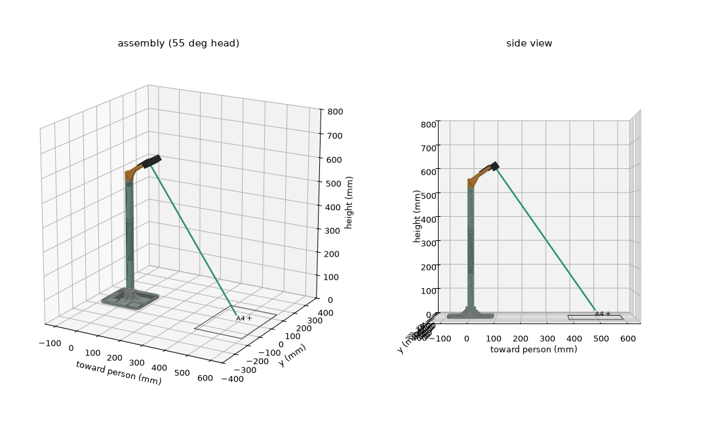

# C920 스탠드 (나사 없음)

Logitech C920 을 웹캠 자리 C 에 두는 스탠드다. 카메라를 종이 + 에서 노트북 쪽으로 40 cm, 높이 60 cm 에 두고 55° 아래를 보게 한다. 자리를 고른 이유는 [웹캠 자리 3D](https://claude.ai/artifact/CqAJvrvBVVqJgyHyxu4duQ) 페이지에 있다.

나사, 볼트, 접착제는 하나도 쓰지 않는다.
- 카메라는 C920 에 원래 달린 모니터 집게로 건다. 스탠드 꼭대기가 기울어진 "가짜 모니터 모서리"(두께 12 mm 판)라서, 모니터 위에 올리듯 걸치면 카메라가 판이 기운 만큼 아래를 본다.
- 기둥은 24 mm 네모 막대를 끼워 잇고, 출력한 핀을 꽂아 빠지지 않게 한다.



## 부품

STL 은 출력할 자세로 이미 눕혀 놓았다. 슬라이서에 그대로 올리면 된다.

| 파일 | 개수 | 크기 (mm) | 하는 일 |
|---|---|---|---|
| `stl/1_base_x1.stl` | 1 | 180 × 180 × 42 | 받침대. 네 귀퉁이 홈에 동전·너트·모래주머니를 넣어 무게를 더한다 |
| `stl/2_pole_segment_x3.stl` | 3 | 24 × 182 × 24 | 기둥 막대. 아래에 촉, 위에 구멍 |
| `stl/3_coupler_x1.stl` | 1 | 16 × 50 × 16 | 기둥 맨 위와 머리를 잇는 양쪽 촉 |
| `stl/4_head_55deg_x1.stl` | 1 | 92 × 87 × 60 | 카메라를 거는 머리 (55° 아래). 자리 C 의 기본 |
| `stl/4_head_45deg_x1.stl`, `4_head_65deg_x1.stl` | 필요하면 1 | | 덜 숙이거나 더 숙이고 싶을 때 |
| `stl/5_pins_x6.stl` | 1 판 (핀 6개) | 지름 3 mm, 길이 27 mm | 이음마다 하나씩 (5개 + 남는 것 1) |

## 출력 설정

PLA 로 층 높이 0.2 mm, 벽 3줄, 채움 20~30% 면 된다. 받침(서포트)은 필요 없다. 머리 안의 네모 구멍 천장은 16 mm 를 건너 출력되는데, PLA 는 보통 이 정도는 받침 없이 된다. 막대는 길고 바닥 면이 좁으니 가장자리(brim)를 켜는 것이 좋다.

막대 하나가 촉까지 182 mm 다. 프린터 판이 이보다 작으면 막대를 4개로 다시 만든다 (아래 "바꾸기").

끼우는 곳은 한쪽에 0.2 mm 씩 틈을 두었다. 너무 빡빡하면 촉을 사포로 조금 갈고, 헐거우면 종이테이프 한 겹을 감는다.

## 조립

1. 받침대 구멍에 첫 막대의 촉을 끝까지 끼운다. 옆 구멍이 맞으면 핀을 꽂는다.
2. 막대 3개를 같은 식으로 쌓는다. 막대마다 위가 구멍, 아래가 촉이다.
3. 맨 위 막대 구멍에 이음촉을 끼우고 핀을 꽂는다.
4. 머리 아래 구멍을 이음촉에 끼우고 핀을 꽂는다. 판이 올라가는 쪽이 종이 쪽을 보게 돌린다.

## 카메라 걸기

모니터 위에 걸 때와 똑같이 건다.
- 카메라 몸통 아래를 판의 높은 끝(걸치는 끝)에 올린다.
- 집게 앞판은 판 아랫면에, 뒷다리는 판 윗면 톱니 위에 놓는다. 톱니는 뒷다리가 아래로 미끄러지지 않게 걸어 주는 턱이다.
- 판 끝 양옆에 홈이 있다. 흔들리면 고무줄이나 벨크로 끈을 이 홈에 걸어 집게째 한 번 감는다.
- 각도는 C920 몸통을 손으로 조금 더 숙이거나 들어서 맞춘다.

## 놓는 자리 (자리 C, 55° 머리)

| 항목 | 값 |
|---|---|
| 카메라 가운데 높이 | 책상에서 약 60 cm |
| 기둥 중심 | 종이 + 에서 노트북 쪽으로 약 49 cm, 좌우 가운데 |
| 카메라 | 기둥보다 9 cm 앞(종이 쪽), 9 cm 위에 걸림 |

노트북은 옆으로 옮겨 화면이 잘 보이게 두고, C920 을 노트북 USB 에 꽂는다. 노트북 프로그램은 카메라 번호만 바꾸면 된다.
```bash
python teleop.py --cam 1 --send 연구실PC주소
```
카메라를 옮겼으니 처음 켤 때 C 를 눌러 종이 모서리부터 다시 보정하고, P 로 위치를 확인한다. `--cam 1` 에서 노트북 내장 카메라가 나오면 `--cam 2` 로 바꾼다.

## 바꾸기

모든 치수는 `make_stand.py` 맨 위에 있고, 자주 바꿀 것은 명령 한 줄로 바꾼다. manifold3d 가 필요하다 (`pip install manifold3d numpy matplotlib`).

| 바꾸고 싶은 것 | 명령 |
|---|---|
| 카메라 높이·각도 (막대 길이가 저절로 맞춰짐) | `python make_stand.py --cam-height 650 --angle 50` |
| 프린터가 작아서 막대를 짧게 | `python make_stand.py --segments 4` |
| C920 집게가 판에서 헐거움 | `python make_stand.py --panel 15` |
| 같이 만들 머리 각도 | `python make_stand.py --extra-angles 40,60,70` |

다시 만들면 `stl/` 이 새 부품으로 바뀌고, 각 머리 각도에서 카메라가 걸리는 높이와 종이 + 까지의 거리가 화면에 나온다.

## 아직 확인하지 않은 것

- C920 집게를 직접 재지 않았다. 12 mm 판을 모니터처럼 잡을 것으로 보고 만들었다. 기둥을 뽑기 전에 머리(55°) 하나만 먼저 출력해서 C920 을 걸어 보는 것이 좋다.
- 출력해 보지 않았다. 부품은 모두 빈틈없이 닫힌 모양(manifold)인지 확인했고, 받침 없이 출력되는 자세인지는 계산으로만 봤다.
- 판을 55° 숙였을 때 C920 이 집게만으로 버티는지는 걸어 봐야 안다. 불안하면 고무줄 홈을 쓴다.
