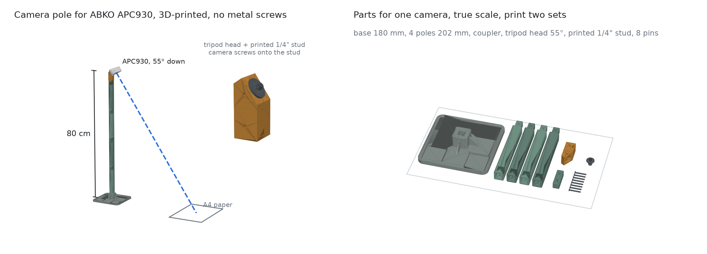

# APC930 카메라 높은 기둥 (금속 나사 없음)

연구실 웹캠 두 대(ABKO APC930)를 책상 위 80 cm 에 두고 55° 아래를 보게 하는 기둥이다. 11/17 의 C920 스탠드([../stand](../stand/README.md))와 같은 기둥에, APC930 에 맞춘 머리를 얹었다. 두 대에 쓰니 **같은 것을 두 벌** 출력한다.



## APC930 에 맞춘 것 (11/25)

제조사(앱코) 상세 설명 그림에서 확인한 것:
- 집게는 "플렉시블 클립"이다. 몸통 아래 윗판, 앞으로 짧게 내려온 턱, 뒤로 접히는 긴 뒷다리가 있다. 노트북 덮개부터 모니터까지 잡는다.
- 뒷다리에 삼각대 구멍이 있다 (제품 사진의 둥근 구멍, 리뷰 기사 "일반 삼각대에 연결").
- 제조사 자료 어디에도 mm 치수는 없다 (사양표, 제품 비교표 모두 확인).

그래서 머리를 두 가지 만들었다.

| 머리 | 붙이는 법 | 언제 |
|---|---|---|
| **4b 삼각대 머리 + 4c 나사 기둥 (기본)** | 머리의 55° 받침에 나사 기둥을 꽂고 핀으로 고정한다. 카메라 뒷다리를 접어 삼각대 구멍을 나사 기둥에 돌려 끼운다 | 집게 크기와 상관없이 맞는다. 먼저 이것을 쓴다 |
| 4a 집게 머리 | 12 mm 판을 모니터처럼 걸친다. 뒷다리가 길어서 다리 끝이 걸리는 톱니 구간을 80 mm 로 늘렸다 | 나사가 안 맞을 때 |

나사 기둥은 1/4인치 20산(일반 삼각대 나사)을 출력한 것이다. 바깥 지름은 금속 암나사에 들어가게 6.35 → 6.15 mm 로 조금 가늘게 했고, 나사 길이는 5 mm 다 (삼각대 구멍 깊이를 몰라서 짧게).

## 부품 (카메라 하나 몫)

STL 은 출력할 자세로 이미 눕혀 놓았다. 받침(서포트)은 필요 없다.

| 파일 | 개수 | 크기 (mm) | 하는 일 |
|---|---|---|---|
| `stl/1_base_x1.stl` | 1 | 180 × 180 × 42 | 받침대. 네 귀퉁이 홈에 동전·너트·모래주머니를 넣어 무게를 더한다 |
| `stl/2_pole_segment_x4.stl` | 4 | 24 × 202 × 24 | 기둥 막대. 아래에 촉, 위에 구멍 |
| `stl/3_coupler_x1.stl` | 1 | 16 × 50 × 16 | 기둥 맨 위와 머리를 잇는 양쪽 촉 |
| `stl/4b_head_tripod_55deg_x1.stl` | 1 | 24 × 58 × 26 | 삼각대 머리 (55° 아래). 옆으로 눕혀 출력 |
| `stl/4c_tripod_stud_x1.stl` | 1 | 지름 20, 높이 19 | 출력 나사 기둥. **세워서** 출력 (나사가 위). 층 0.12~0.16 mm 로 곱게 |
| `stl/5_pins_x8.stl` | 1 판 (핀 8개) | 지름 3 mm | 이음 6곳 (받침·막대 4곳, 이음촉 위아래 2곳) + 나사 기둥 고정 1개 + 남는 것 1 |
| `stl/4a_head_clip_55deg_x1.stl` | 필요하면 1 | 92 × 87 × 60 | 집게 머리 (55°) |
| `stl/4b_head_tripod_45·65deg`, `4a_head_clip_45·65deg` | 필요하면 | | 덜 숙이거나 더 숙이고 싶을 때 |

부품 11가지 모두 빈틈없이 닫힌 모양(manifold)이고, 삼각대 머리·나사 기둥·핀을 끼운 상태에서 서로 겹치는 부피가 0 인지 계산으로 확인했다 (45·55·65° 모두). 막대가 촉까지 202 mm 라서 프린터 판이 210 mm 보다 작으면 `--segments 5` 로 다시 만든다.

## 조립

1. 받침대 → 막대 4개 → 이음촉 → 삼각대 머리 순서로 끼우고, 이음마다 핀을 꽂는다 (C920 스탠드와 같음).
2. 나사 기둥의 아래 촉을 머리의 기울어진 받침 구멍에 끝까지 꽂고, 옆 구멍에 핀을 꽂는다.
3. APC930 뒷다리를 윗판 쪽으로 접어 삼각대 구멍이 아래를 보게 하고, 카메라째 돌려 나사 기둥에 끼운다. 렌즈가 기둥 반대쪽(종이 쪽)을 보게 맞춘다.
4. 나사가 빡빡하면 `python make_stand.py --thread 6.0`, 헐거우면 `--thread 6.3` 으로 나사 기둥만 다시 뽑는다.

## 놓는 자리 (기둥 중심 기준)

| 머리 | 카메라 가운데 높이 | 기둥에서 카메라까지 (사람 쪽) | 기둥에서 종이 + 까지 |
|---|---|---|---|
| 삼각대 45° | 80.6 cm | 3.6 cm | 81.1 cm |
| **삼각대 55° (기본)** | **80.0 cm** | **3.7 cm** | **57.6 cm** |
| 삼각대 65° | 79.4 cm | 3.7 cm | 39.3 cm |
| 집게 55° | 83.7 cm | 9.3 cm | 65.8 cm |

카메라 높이는 APC930 을 제조사 그림으로 어림한 크기(받침 위 29 mm 에 렌즈)로 계산했다. 카메라를 옮겼으니 처음 켤 때 종이 모서리 보정부터 다시 한다 (사용설명서 5절).

## 출력 설정

PLA, 층 0.2 mm (나사 기둥만 0.12~0.16 mm), 벽 3줄, 채움 20~30%. 막대는 가장자리(brim)를 켠다. 나머지는 [C920 스탠드 설명](../stand/README.md#출력-설정)과 같다.

## 다시 만들기

```bash
python make_stand.py                     # stl/ 과 preview.png (기본: 삼각대 머리 기준 80 cm, 55°, 막대 4개)
python render.py                         # render.png (주간보고 그림)
python make_stand.py --mount clip        # 기둥 길이를 집게 머리 기준으로
python make_stand.py --cam-height 900 --segments 5   # 더 높이
```
manifold3d, numpy, matplotlib 가 필요하다.

## 아직 확인하지 않은 것

- 출력해 보지 않았다.
- APC930 의 삼각대 구멍이 1/4인치 20산인지, 깊이가 5 mm 넘는지 재 보지 않았다. 일반 삼각대에 연결된다는 리뷰와 제품 사진만 봤다.
- 출력한 나사가 금속 암나사에 잘 물리는지는 해 봐야 안다. 산 모양이 둥근 출력 나사라 진짜 나사보다 덜 물린다.
- 집게 머리의 12 mm 판과 80 mm 톱니가 APC930 뒷다리에 맞는지 재 보지 않았다.
- 80 cm 기둥이 18 cm 받침으로 넘어지지 않는지는 세워 봐야 안다. 받침 홈에 무게를 넣는 것을 권한다.
- 높은 곳에서 손이 더 잘 보이는지는 측정해 보지 않았다 (11/27 주간보고의 다음 할 일).
