# 웹캠 PiPER 원격조종 사용 설명서

> 한 줄 요약: 노트북 카메라로 사람 손을 보고 PiPER 집게가 같은 만큼 따라 움직이게 해서, VR 장비 없이 시범 데이터를 모으는 프로그램의 사용법

- 사람이 책상 위에서 손 전체로 물체를 쥐면, 로봇 책상의 같은 자리에 놓인 같은 물체를 PiPER 집게가 같은 방향으로 쥔다.
- 카메라는 노트북 것 하나면 되고, 팔은 연구실 PC 에 붙어 있어도 된다. 노트북은 손 위치 숫자만 연구실 PC 로 보낸다.
- 처음에는 팔 없이 화면 속 가상 팔로 연습하고, 손 위치가 맞는지 확인한 뒤 실물로 넘어간다.
- 보정은 손을 종이 위에 펴서 올려놓기만 하면 된다.
- 2026-11-16 기준으로 가짜 카메라와 가상 팔로만 시험했다. 실제 노트북 카메라와 실물 팔은 아직이다 (12절).

코드와 기술 설명은 [README.md](README.md) 에 있다. 이 문서는 처음 쓰는 사람이 순서대로 따라 하는 용도다. 노트북의 Claude 에 설치와 점검을 맡길 때는 [노트북_실행.md](노트북_실행.md) 링크를 주면 된다.

## 목차

1. [어떻게 움직이나](#1-어떻게-움직이나)
2. [준비물](#2-준비물)
3. [설치](#3-설치)
4. [책상 놓기](#4-책상-놓기)
5. [노트북 혼자 연습하기 (팔 없음)](#5-노트북-혼자-연습하기-팔-없음)
6. [연구실 PC 와 연결하기](#6-연구실-pc-와-연결하기)
7. [실물 팔로 시범 기록하기](#7-실물-팔로-시범-기록하기)
8. [키 정리](#8-키-정리)
9. [안전 수칙](#9-안전-수칙)
10. [기록 파일](#10-기록-파일)
11. [문제가 생기면](#11-문제가-생기면)
12. [지금까지 확인한 것과 남은 것](#12-지금까지-확인한-것과-남은-것)

## 1. 어떻게 움직이나

규칙은 하나다. 사람 손이 시작 표시에서 움직인 만큼, 로봇 집게 끝도 로봇 시작 표시에서 똑같이 움직인다. 1 cm 를 움직이면 1 cm 를 움직인다.

사람은 컵을 위에서 쥐듯이 손 전체로 쥔다. 엄지가 한쪽, 나머지 네 손가락이 맞은편이다. 로봇 집게는 손가락이 둘이라 엄지가 집게 한쪽, 네 손가락이 다른 쪽과 짝이 된다. 기준점은 엄지 끝과 네 손가락 끝 가운데의 가운데다. 이 문서에서는 이 점을 집기점이라고 부른다. 물체를 쥘 때 물체가 오는 자리라서, 이 점이 로봇 집게 끝(두 손가락 가운데)과 같은 일을 한다.

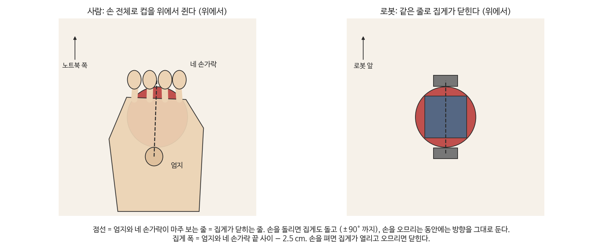

| 사람이 하는 것 | 로봇이 하는 것 |
|---|---|
| 집기점을 앞·뒤·왼쪽·오른쪽·위·아래로 옮김 | 집게 끝이 같은 방향으로 같은 거리만큼 옮김 |
| 손을 책상 위에서 돌림 (엄지와 네 손가락이 마주 보는 줄이 돌아감) | 집게가 아래를 본 채 같은 줄로 닫히게 돌아감 |
| 손을 펴고 오므림 (엄지와 네 손가락 끝 사이) | 집게를 벌리고 좁힘 (그 사이 − 25 mm) |

손을 오므리는 동안(엄지와 네 손가락 사이가 5 cm 보다 좁을 때)에는 집게 방향을 새로 읽지 않는다. 쥐는 순간에 엄지·손가락 줄이 흔들려도 집게가 돌지 않게 하려는 것이다. 작은 물체는 엄지와 검지로만 집는 방식도 있다. 프로그램을 켠 채 TAB 키로 바꾼다 (8절).

원래 코드(My_portfolio `2026/05. 웹캠 로봇팔 원격조종`, SO-ARM101)는 사람 팔의 관절 각도를 로봇 관절에 그대로 옮겼다. PiPER 는 팔 길이가 사람과 달라서 각도를 그대로 옮기면 집게가 엉뚱한 곳으로 간다. 그래서 집게 끝 위치만 맞추고, 관절 각도는 프로그램이 계산한다(역기구학).

## 2. 준비물

| 무엇 | 설명 |
|---|---|
| 노트북 | 웹캠이 달린 것. Python 3.10~3.12 |
| 연구실 PC | PiPER 가 CAN-USB 로 붙어 있는 컴퓨터. 찬혁님 piper-teleop 가상환경이 있으면 따로 깔 것이 없다 |
| A4 종이 2장 | 사람 책상에 1장, 로봇 책상에 1장. 둘 다 한가운데에 연필로 + 표시 |
| 같은 물체 2개 | 사람 쪽과 로봇 쪽에 하나씩. 컵, 블록 등 집기 쉬운 것 |
| 같은 망 | 노트북과 연구실 PC 가 서로 닿아야 한다 (6절). 노트북 혼자 연습할 때는 필요 없다 |
| 로봇 쪽 카메라 (선택) | 기록에 로봇 손목·앞 카메라 사진을 넣으려면 연구실 PC 에 USB 카메라를 붙인다 |

종이 한가운데는 가로로 놓았을 때 왼쪽 끝에서 148 mm, 앞쪽 끝에서 105 mm 인 곳이다.

## 3. 설치

### 노트북

이 폴더(`webcam_piper`)를 노트북에 복사하고, 그 폴더에서 터미널을 연다.

Windows (PowerShell):
```bash
py -3.11 -m venv .venv
```
```bash
.venv\Scripts\activate
```
Mac, Linux:
```bash
python3 -m venv .venv
```
```bash
source .venv/bin/activate
```
그다음은 공통이다.
```bash
pip install -r requirements.txt
```
```bash
python download_models.py
```
두 번째 명령은 MediaPipe 손 모델(약 7.5 MB)을 `models/` 에 내려받는다. 처음 한 번만 하면 된다.

코드를 새로 받을 일은 없다. `teleop.py` 와 `check_setup.py` 는 켤 때마다 GitHub 에서 새 코드를 스스로 받아 오고, 받은 것이 있으면 저절로 다시 켠다. 켤 때 `[업데이트] 새 코드 받음` 이 나오면 받은 것이다. 인터넷이 안 되면 그냥 지금 코드로 켠다. 이 기능을 끄려면 명령 끝에 `--no-update` 를 붙인다.

설치가 맞는지는 점검 프로그램으로 확인한다. 프로그램, 손 모델, 계산 시험, 웹캠을 차례로 보고 마지막 줄에 `점검: 모두 됨` 이 나오면 된다. 웹캠 사진 한 장을 `cam_check.jpg` 로 남기니 종이가 잘 보이는지도 볼 수 있다.
```bash
python check_setup.py
```
계산 시험만 따로 돌리려면 `python test_geometry.py` 를 쓴다. 맨 끝 줄이 `결과: 모두 통과 (53개)` 면 된다 (11/23 기준, 시험을 더할 때마다 늘어난다). 11/16 에 Python 3.12 로 MediaPipe 1.2.3·OpenCV 5.0 과 MediaPipe 0.10.21·OpenCV 4.11 둘 다 시험해서 됐다. 인텔 맥은 MediaPipe 새 판이 없어 Python 3.12 이하여야 한다.

Mac 은 처음 실행할 때 터미널 앱에 카메라 권한을 달라는 창이 뜬다. 허용해야 화면이 나온다.

### 연구실 PC

연구실 PC 에는 같은 폴더가 `~/smolVLA/webcam_piper` 에 있다. 찬혁님 piper-teleop 가상환경(`~/smolVLA/chanhyuk_piper-teleop/.venv`)에 numpy, opencv, agx-bus 가 다 있어서 더 깔 것이 없다. 연구실 PC 쪽 프로그램은 MediaPipe 도 mujoco 도 쓰지 않는다.

## 4. 책상 놓기

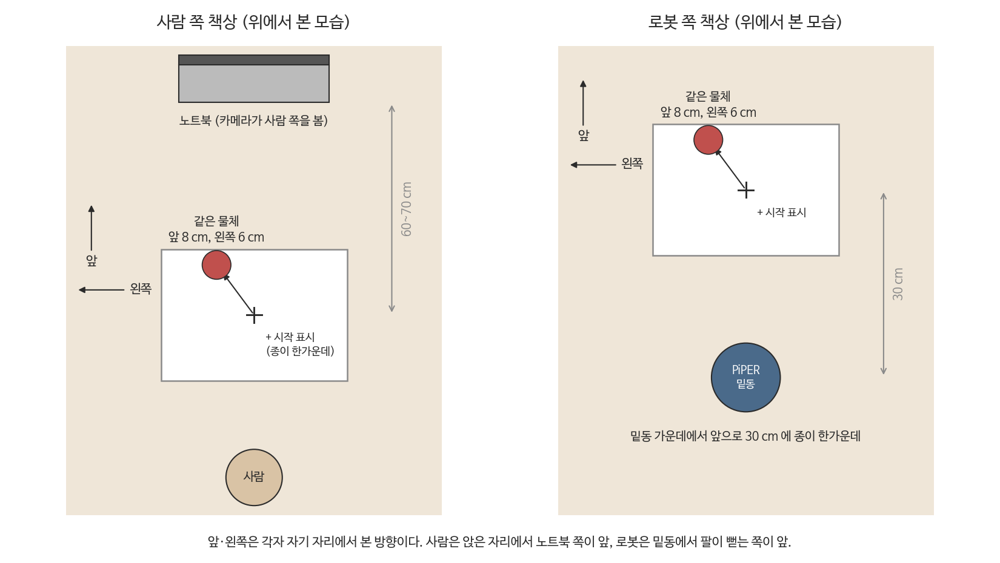

사람 쪽
- 노트북은 책상 위에 그대로 두고 사람과 마주 보게 한다. 화면을 세우고 아주 살짝 앞으로 숙인다.
- A4 를 가로로, 노트북에서 60~70 cm 앞(사람 쪽)에 놓는다. 노트북 카메라 화면에 종이 네 모서리가 다 보여야 한다.
- 종이 위 20 cm 까지 손을 들어도 화면 안에 있는지 카메라 앱으로 먼저 본다.
- 사람 뒤에 창문이 있으면(역광) 손을 잘 못 찾는다.

로봇 쪽
- A4 를 가로로, 종이 한가운데가 로봇 밑동 가운데에서 앞으로 30 cm 인 곳에 놓는다.
- 같은 물체를 두 종이의 같은 자리에 놓는다. 예를 들어 둘 다 + 에서 앞으로 8 cm, 왼쪽으로 6 cm.
- 앞과 왼쪽은 각자 자기 자리에서 본 방향이다. 사람은 앉은 자리에서 노트북 쪽이 앞이고, 로봇은 밑동에서 팔이 뻗는 쪽이 앞이다.

보정 자세

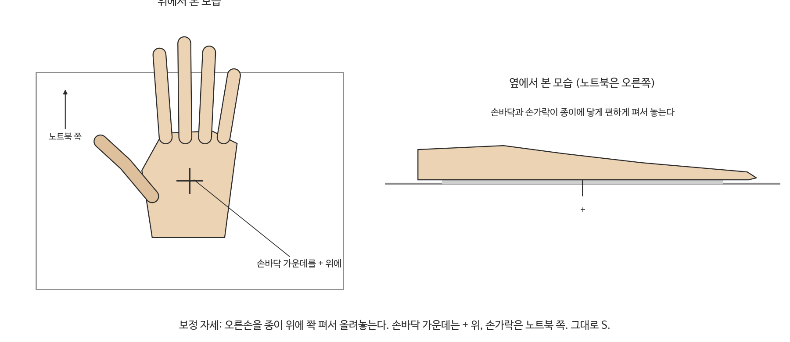

오른손을 종이 위에 쫙 펴서 올려놓는다. 손바닥 가운데가 + 위에 오고, 손가락은 노트북 쪽을 향하게 한다. 손바닥과 손가락이 종이에 닿아 있으면 된다. 누구나 바로 따라 할 수 있고, 손 전체가 종이에 붙어 있어서 재기도 쉽다.

MediaPipe 는 사람 손 크기를 정확히 모른다. 그래서 이 자세에서 손 21점이 모두 종이 바로 위(손가락 끝 0.6 cm, 손가락 뿌리 1.3 cm, 손목 1.8 cm 안팎, 살 두께의 절반쯤)에 있다는 것을 이용해 손 크기를 맞춘다.

로봇 쪽에는 보정이 없다. 두 종이의 + 가 짝이라서, 사람 집기점이 사람 종이 + 에서 어디에 있든 로봇 집게 끝은 로봇 종이 + 에서 같은 곳에 간다.

## 5. 노트북 혼자 연습하기 (팔 없음)

처음에는 팔 없이 노트북에서만 돌려서 보정을 하고 손 위치가 맞는지 확인한다.
```bash
python teleop.py
```
화면 왼쪽은 노트북 카메라(거울처럼 좌우가 뒤집혀 보인다), 오른쪽은 가상 PiPER 다. 오른쪽 그림의 위쪽은 로봇 책상을 위에서 본 것이고, 아래쪽은 옆에서 본 것이다. 화면 글자는 영어다(OpenCV 가 한글을 못 그린다).

아래 화면들은 실제 카메라 대신 그린 책상·종이·손으로 프로그램을 돌려 찍은 것이다. 실제로는 노트북 카메라 화면이 나온다.

### 5-1. 종이 모서리 누르기 (보정 1/2)

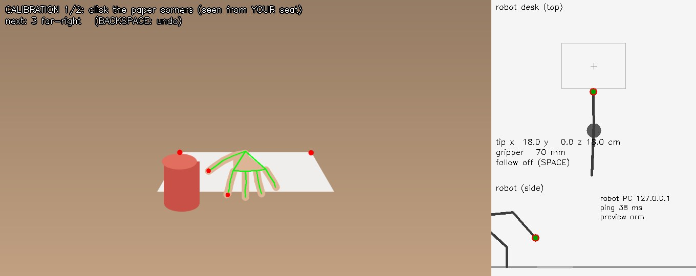

화면에서 종이 모서리 네 개를 마우스로 차례대로 누른다. 순서는 내 자리에서 본 방향으로 센다.

| 순서 | 화면 글자 | 어느 모서리 |
|---|---|---|
| 1 | near-left | 내 쪽, 왼쪽 |
| 2 | near-right | 내 쪽, 오른쪽 |
| 3 | far-right | 노트북 쪽, 오른쪽 |
| 4 | far-left | 노트북 쪽, 왼쪽 |

잘못 눌렀으면 Backspace 로 하나 지운다. 이 네 점으로 카메라가 종이를 어느 높이, 어느 각도에서 보는지와 카메라 렌즈의 초점거리를 계산한다.

### 5-2. 확인

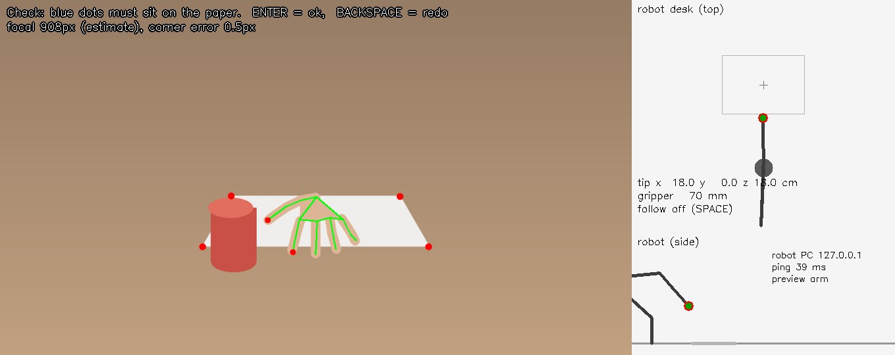

파란 테두리와 점들이 종이 위에 고르게 앉아 있으면 Enter, 어긋나 있으면 Backspace 로 다시 누른다. 위에 나오는 `corner error` 가 2~3 px 이하면 잘 누른 것이다.

### 5-3. 손 펴서 올려놓기 (보정 2/2)

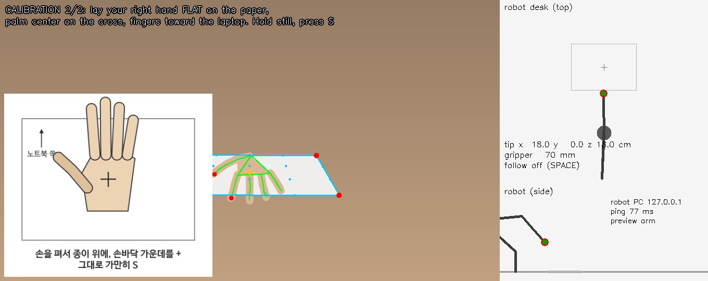

4절의 보정 자세로 손을 종이 위에 펴서 올려놓고, 손바닥 가운데를 노란 + 에 맞춘 뒤 S 를 누른다. 다른 손은 화면 밖에 둔다. 이때 MediaPipe 가 이 손을 'Left' 와 'Right' 중 무엇이라 부르는지 재 두었다가, 나중에 두 손이 다 보이면 그 이름인 손을 따라간다. 화면 왼쪽 아래에 이 자세 그림이 뜬다. 20장을 찍는 동안(1초 남짓) 움직이지 않는다.

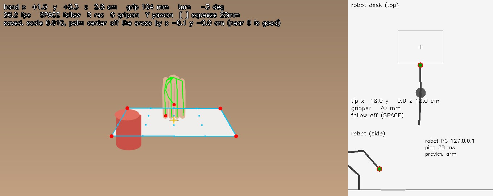

`saved. scale .., palm center off the cross by x .. y .. cm` 이 나오면 끝이다. 손바닥 가운데를 + 에 정확히 두었다면 이 x, y 가 곧 위치 오차다. 1 cm 안쪽이면 좋다. 보정값은 `calib.json` 에 저장되고, 다음에 켜면 바로 불러온다. 노트북이나 종이를 옮겼으면 C 를 눌러 처음부터 다시 한다.

### 5-4. 손 위치가 맞는지 확인

다섯 손가락 끝을 한데 모아 종이 모서리 네 곳에 차례로 대 보고, 화면 왼쪽 위 `hand x .. y .. z ..` 를 읽는다. 손가락 끝을 모으면 집기점이 그 끝에 온다.

읽는 대신 손가락 끝을 댄 채 P 를 눌러도 된다. 가장 가까운 모서리(또는 +)와 몇 cm 다른지 화면에 뜨고 `checks.jsonl` 에 남는다. + 와 네 모서리에서 한 번씩 누른 뒤 프로그램을 끄고 `python check_setup.py --report` 를 치면 보정 값과 함께 한 덩어리로 정리해 준다. 연구실에 알려 줄 때 이것을 붙여 넣는다.

| 모서리 | 맞으면 |
|---|---|
| 내 쪽, 왼쪽 | x −10.5, y +14.9 |
| 내 쪽, 오른쪽 | x −10.5, y −14.9 |
| 노트북 쪽, 오른쪽 | x +10.5, y −14.9 |
| 노트북 쪽, 왼쪽 | x +10.5, y +14.9 |

z 는 손가락 끝을 종이에 댔을 때 1 cm 안팎이면 된다. 1~2 cm 쯤 틀리는 것은 괜찮고, 몇 cm 넘게 틀리면 C 로 다시 보정한다. 그래도 크게 틀리면 카메라를 더 높이 두는 것이 가장 효과가 크다 (11절).

### 5-5. 가상 팔로 연습

SPACE 를 누르면 오른쪽 가상 팔이 손을 따라 움직인다. 빨간 동그라미가 목표, 초록 점이 집게 끝이다. 물체를 쥐고, 들고, 옮기고, 놓는 동작을 몇 번 해 보면서 손이 화면 밖으로 나가지 않는지, 가상 팔이 자연스럽게 따라오는지 본다. 다시 SPACE 를 누르면 멈춘다.

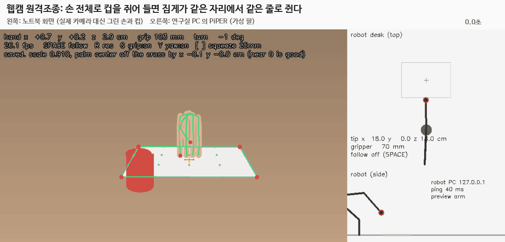

위 움직이는 그림도 그린 손과 컵으로 돌린 것이다. 손이 컵을 쥐고 10 cm 들어 올리는 동안, 오른쪽 팔의 집게 끝이 로봇 종이에서 같은 자리·같은 높이로 가고 집게가 31 mm 로 닫힌다.

## 6. 연구실 PC 와 연결하기

팔은 연구실 PC 에 붙어 있고 카메라는 노트북에 있으므로, 둘을 나눠서 돌린다.

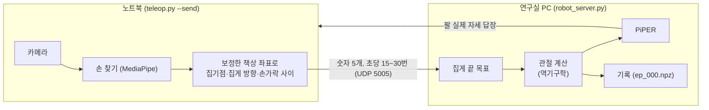

노트북은 사진을 보내지 않고 숫자 다섯 개(집기점 x, y, z, 집게 방향, 엄지와 네 손가락 사이)만 보낸다. 그래서 와이파이로 충분하다. 연구실 PC 가 팔의 실제 자세를 답장으로 보내 주므로, 노트북 화면 오른쪽에는 연구실 팔이 지금 어떤 자세인지 나온다.

### 6-1. 연구실 PC 에서 받는 쪽 켜기 (먼저 팔 없이)

```bash
cd ~/smolVLA/webcam_piper
```
```bash
~/smolVLA/chanhyuk_piper-teleop/.venv/bin/python robot_server.py
```
켜지면 터미널에 `이 PC 주소: ...` 가 나온다. 이 주소를 노트북에 쓴다. 이렇게 옵션 없이 켜면 실물 팔이 아닌 가상 팔로 돈다.

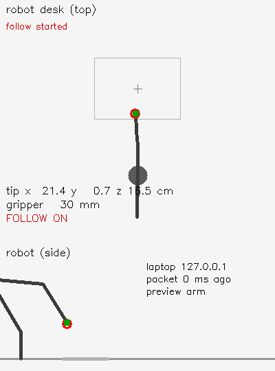

연구실 PC 창 오른쪽 아래에 연결된 노트북 주소와 마지막 신호가 몇 ms 전에 왔는지가 나온다.

### 6-2. 노트북에서 보내기

```bash
python teleop.py --send 연구실PC주소
```
`연구실PC주소` 자리에 6-1 에서 본 주소를 쓴다 (예: `--send 192.168.0.10`). 포트를 바꿨다면 `--send 192.168.0.10:5006` 처럼 쓴다. 보정은 노트북에서 5절과 똑같이 한다.

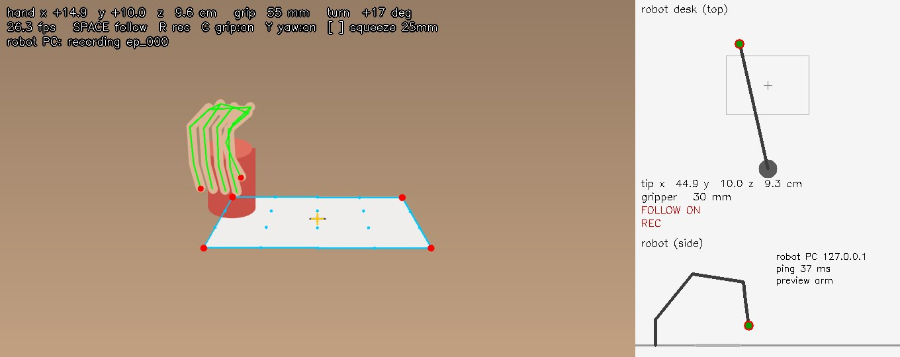

연결되면 노트북 화면 오른쪽 아래에 `robot PC 주소`, `ping .. ms`, `preview arm`(가상 팔) 또는 `REAL ARM`(실물)이 나온다. 위 화면은 따라가기(FOLLOW ON)와 기록(REC)을 켠 채 손을 물체 자리로 옮긴 모습이다.

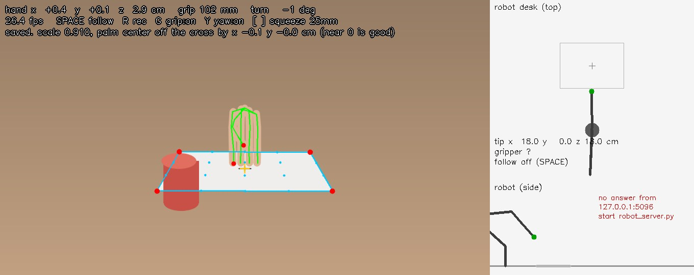

빨간 글씨로 `no answer from` 이 나오면 연결이 안 된 것이다. 11절을 본다.

### 6-3. 두 컴퓨터가 서로 닿는지

노트북에서 연구실 PC 주소로 ping 이 되면 된다.
```bash
ping 연구실PC주소
```
연구실 유선망과 와이파이가 서로 다른 망이면 ping 이 안 될 수 있다. 그때는 두 컴퓨터를 같은 공유기에 붙이거나, 둘 다 Tailscale 같은 사설망 프로그램에 같은 계정으로 넣고 그 주소(100. 으로 시작)를 쓴다. Tailscale 을 쓰면 연구실 밖에서도 된다. 다만 실물 팔을 움직일 때는 팔 옆에 사람이 있어야 한다 (9절).

## 7. 실물 팔로 시범 기록하기

### 7-1. 켜기

**가장 쉬운 방법 (11/20): 바탕화면 'PiPER 조종' 아이콘.** 누르면 창이 두 개 뜬다.
- 'PiPER 서버' 창: CAN 이 꺼져 있으면 켠다 (비밀번호는 사람이 넣는다). 팔이 교시 모드면 풀릴 때까지 기다린다. 안전 안내가 나오면 팔 둘레를 비우고 Enter 를 누른다.
- 'PiPER 카메라' 창: 서버가 켜지면 연구실 PC 카메라 두 대로 손을 잰다 (`--cam 0 --cam2 2`).

노트북 카메라로 하거나 설정을 바꿀 때는 아래처럼 하나씩 켠다.

**처음 자세 저장 (한 번만, 11/20).** 팔을 교시 모드로 두고 손으로 끌어 시작할 자세에 맞춘 다음 저장한다.
```bash
.venv/bin/python save_home.py
```
`home_pose.json` 에 관절 각도가 남는다. 팔이 보내는 각도를 듣기만 하고 명령은 보내지 않는다. 집게 끝을 책상에서 2~3 cm 띄운 채 저장한다. 책상에 닿은 채 저장하면 그대로 돌아갈 때 책상을 밀어서 팔이 충돌로 멈출 수 있다 (11/23). 그래서 3 cm 보다 낮으면 B 는 같은 방향으로 3 cm 까지 들어 올린 자세로 간다. 저장한 다음 교시 모드를 끈다 (버튼으로 꺼도 교시로 남아 있으면 전원을 껐다 켠다).
SPACE 를 누르면 팔은 그 자세 그대로 있고, 그 순간의 손 자리가 지금 집게 끝이 된다 (11/23 오후부터). 손이 종이 + 에서 조금 벗어나 있거나 손바닥이 기울어 있어도 팔은 움직이지 않는다. 그 뒤로 손이 움직인 만큼, 손이 돈 만큼 집게가 따라간다. 그리퍼는 손가락을 1 cm 넘게 오므리거나 펴야 따라가기 시작한다. 예전처럼 종이 + 를 기준으로 하려면 robot_server 에 `--start paper` 를 붙인다 (그때는 + = 처음 자세 집게 끝).

연구실 PC 에서 CAN 을 켠다.
```bash
sudo ip link set can0 up type can bitrate 1000000
```
받는 쪽을 실물 팔로 켠다. 처음에는 집게가 손보다 10 cm 위에서, 천천히 따라가게 한다 (11/18).
```bash
~/smolVLA/chanhyuk_piper-teleop/.venv/bin/python robot_server.py --robot agxbus --speed 30 --lift 0.10 --max-speed 0.3
```
손 높이와 움직임이 맞는 것을 본 다음 사람 손 빠르기로 올린다 (연구실 VR 조종과 같은 100%).
```bash
~/smolVLA/chanhyuk_piper-teleop/.venv/bin/python robot_server.py --robot agxbus --speed 100
```
터미널에 안전 안내가 나오고 Enter 를 기다린다. 팔 둘레를 비우고, 전원 스위치 옆에 사람이 선 다음 Enter 를 누른다. 연구실 PC 에 손목·앞 카메라를 붙였으면 `--wrist-cam 0 --front-cam 2` 처럼 카메라 번호를 더한다.

노트북에서 보낸다.
```bash
python teleop.py --send 연구실PC주소
```
노트북 화면 오른쪽 아래에 빨간 `REAL ARM` 이 나오는지 본다.

### 7-2. 시범 한 번 하는 순서

1. 처음 자세를 저장해 두었으면 B 를 눌러 집게를 처음 자세로 보낸다. 손을 편하게 펴서 종이 + 위 몇 cm 에 둔다.
2. SPACE 를 누른다. 팔은 그 자세 그대로다 (11/23 오후부터). 그리퍼도 닫힌 채로 있다가, 손가락을 1 cm 넘게 오므리거나 펴면 따라간다. 물체 자리를 두 책상에서 맞추려면 손을 종이 + 위에 두고 SPACE 를 누른다.
3. R 을 눌러 기록을 시작한다.
4. 물체 위로 손을 가져가 손 전체로 쥐고, 들어서 옮기고, 손을 펴서 놓는다. 천천히, 손가락 끝이 카메라에 잘 보이게 한다.
5. 손을 다시 + 위로 가져온다.
6. R 을 눌러 기록을 끝낸다. 연구실 PC 에 `ep_000.npz` 처럼 저장되고, 노트북 화면에 `robot PC: saved ep_000.npz (.. frames)` 가 나온다.
7. 방금 시범이 잘못됐으면 X 를 눌러 마지막 기록을 지운다.
8. 물체를 두 책상 모두 같은 새 자리에 놓고 1번부터 다시 한다.

끝낼 때는 노트북에서 Q 를 누른다. 연구실 PC 도 팔을 그 자리에 멈추고, 기록 중이었으면 저장한다. 팔은 힘이 켜진 채로 그 자리에 있다. 연구실 PC 창에서도 Q 로 끈다.

### 7-3. 잘 모으는 요령

- 처음 몇 번은 그리퍼를 끄고(G) 팔 위치만 맞는지 본다. 11/12 시험에서 그리퍼가 명령에 반응하지 않은 적이 있다.
- 물체를 쥐는 세기는 [ ] 로 바꾼다. 집게 폭은 엄지와 네 손가락 끝 사이에서 이 값(처음 25 mm)을 뺀 것이다. 물체를 쥐었는데 로봇이 헐겁게 쥐면 ] 를 눌러 더 뺀다.
- 손을 돌리면 집게도 돌아간다. 엄지와 네 손가락이 마주 보는 줄이 물체를 가로지르게 쥐면 집게도 그 줄로 닫힌다. 돌릴 필요가 없는 일이면 Y 로 꺼 두면 집게가 그 방향 그대로 있다.
- 손가락 끝을 오른쪽으로 돌리는 데는 끝이 있다. 6번 관절 끝에 닿으면 집게가 더 돌지 않는다. 종이 가운데에서는 20° 남짓, 로봇 오른쪽 끝에서는 50° 남짓 돌릴 수 있고, 로봇 왼쪽 끝에서는 거의 못 돌린다 (손을 똑바로 두어도 4° 쯤 덜 돈다). 왼쪽으로 돌리는 것은 어디서나 넉넉하다.
- 펜이나 작은 블록처럼 손 전체로 쥐기 어려운 것은 TAB 을 눌러 엄지와 검지로 집는다. 다시 TAB 을 누르면 손 전체로 돌아온다. 따라가기 중에 누르면 팔이 멈추니, 손 모양을 잡은 뒤 SPACE 로 다시 켠다.
- 손을 화면 밖으로 내거나 1초 넘게 가리면 따라가기가 꺼진다. 다시 SPACE.
- 손떨림과 한 장면만 튀는 값은 기본으로 거른다 (11/20). 손이 멈춰 있을 때 3 mm 안에서 떨리면 팔은 그대로 있다. 끄려면 `--no-steady`.
- 손바닥이 향한 쪽으로 집게도 향한다 (11/23). 손등이 보이게 엎으면 집게는 아래, 손바닥을 옆으로 세우면 옆, 위로 뒤집으면 위쪽으로 돈다.
  다만 PiPER 손목이 꺾이는 데 한계가 있어서, 책상 가까이에서는 집게가 옆 안팎까지만 돈다 (손을 높이 들수록 더 위로 섬). 집게를 세우면 책상에 닿지 않게
  집게 끝이 먼저 조금 올라간다. 위에서 쥐는 일만 할 때는 `--down-only` 로 끄면 11/22 까지처럼 집게가 늘 아래를 본다.

## 8. 키 정리

노트북 창에서 누른다.

| 키 | 하는 일 |
|---|---|
| SPACE | 따라가기 켜기·끄기 |
| R | 기록 시작·끝 (연결해서 쓰면 연구실 PC 에 저장) |
| X | 마지막 기록 지우기 |
| B | 처음 자세로 돌아가기 (11/20, 연구실 PC 와 쓸 때). 따라가기가 꺼지고 저장한 자세로 부드럽게 간다. 그리퍼도 닫힌다 (11/23). 저장한 자세의 집게 끝이 책상에 가까우면 (가상 팔 모델로 3 cm 아래) 같은 방향으로 3 cm 까지 들어 올린 자세로 간다 (11/23 책상에 박은 일). 가는 중 SPACE = 그 자리에 멈춤 |
| Z | 손끝 높이 맞추기 (11/19). 엄지와 손가락 끝을 종이에 대고 누르면 그 높이를 책상 높이로 잡는다 |
| G | 집게 따라가기 켜기·끄기 (끄면 집게는 그대로) |
| Y | 집게 돌림 따라가기 켜기·끄기 (끄면 그 방향 그대로) |
| [ / ] | 집게를 5 mm 더 약하게 / 세게 쥠 |
| C | 종이 모서리부터 다시 보정 |
| S | 손 펴서 올려놓기(보정 2/2)만 다시 |
| P | 위치 확인: 손가락 끝을 모아 모서리나 + 에 대고 누르면 차이를 띄우고 `checks.jsonl` 에 남김 |
| TAB (또는 H) | 손 모양 바꾸기: 손 전체 ↔ 엄지·검지. 화면 위에 `TAB hand: WHOLE HAND` / `THUMB+INDEX` 로 나오고, 빨간 점이 지금 쓰는 손가락 끝이다. 따라가기 중이면 멈추므로 SPACE 로 다시 켠다. 쥐는 세기([ ])는 모양마다 따로 기억한다. TAB 은 한글 입력 상태에서도 먹힌다 |
| Q, ESC | 끝 |

연구실 PC 창에서는 SPACE 가 멈춤·풀기, Q 가 끝이다. 연구실 PC 에서 멈추면 노트북에서 SPACE 를 다시 눌러야 움직인다.

## 9. 안전 수칙

프로그램이 막아 주는 것
- 실물 팔이면 연구실 PC 에서 Enter 를 눌러야 시작한다.
- 노트북에서 따라가기가 이미 켜진 채로 연결돼도 움직이지 않는다. 노트북 따라가기가 저절로 꺼지고, SPACE 를 다시 눌러야 움직인다.
- 노트북 신호가 0.5초 넘게 끊기면(와이파이 끊김, 노트북 멈춤) 그 자리에 멈추고 따라가기를 끈다. 신호가 돌아와도 SPACE 를 누르기 전에는 움직이지 않는다.
- 손을 1초 넘게 못 찾으면 따라가기를 끈다.
- 처음 연결한 노트북 하나의 신호만 받는다. 다른 컴퓨터가 보낸 것은 무시한다.
- 집게 끝은 초당 12 cm, 관절은 초당 1 rad, 집게 돌림은 초당 60° 를 넘지 않는다.
- 집게는 반 바퀴씩 휙 돌지 않는다. 돌릴 수 있는 끝에 닿으면 거기서 멈춘다.
- 집게 끝이 갈 수 있는 곳을 책상 6 mm 위부터 25 cm 위까지, 밑동 앞 14~50 cm, 좌우 25 cm 안으로 자른다. 사람 손이 더 멀리 가도 로봇은 이 상자 끝에서 멈춘다.

사람이 지킬 것
- 실물 팔을 움직이는 동안에는 팔 옆에 사람이 있어야 한다. 전원 스위치에 손이 닿는 곳에 선다.
- 팔이 닿는 곳에 다른 물건이나 사람 손을 두지 않는다.
- 처음에는 `--speed 30 --lift 0.10 --max-speed 0.3` 으로 한다. 손 높이·움직임이 맞는 것을 본 다음에 `--speed 100` (사람 손 빠르기, 11/18).
- 이상하면 노트북 SPACE, 연구실 PC 창 SPACE, 전원 스위치 순서로 멈춘다.
- 끝나도 팔은 힘이 켜진 채 그 자리에 있다. 힘을 끄면 팔이 바로 떨어지므로, 끌 때는 팔을 손으로 받친다.

## 10. 기록 파일

연결해서 쓰면 연구실 PC 의 `~/smolVLA/webcam_piper/data/날짜_시각/ep_000.npz` 에 저장된다(노트북 혼자 쓰면 노트북의 `data/`). 같은 폴더의 `meta.json` 에 그때의 옵션이 있다.

```python
import numpy as np
d = np.load("data/20261116_101500/ep_000.npz", allow_pickle=True)
print(d["q"].shape)          # (장면 수, 6) 실제 관절 각도
```

| 이름 | 뜻 |
|---|---|
| `t` | 시각 (초) |
| `q`, `grip` | 팔이 실제로 간 관절 6개 (rad), 집게 폭 (m) |
| `q_cmd`, `grip_cmd` | 팔에 보낸 관절 목표, 집게 폭 목표 |
| `hand`, `hand_yaw`, `hand_gap` | 사람 집기점 (사람 종이 좌표, m), 엄지 → 네 손가락 줄에 맞춘 집게 yaw (rad), 엄지와 네 손가락 끝 사이 (m) |
| `target` | 집게 끝 목표 (로봇 좌표, m) |
| `tracked`, `follow` | 손을 찾았는지, 따라가기가 켜져 있었는지 |
| `seq`, `link_age` | 노트북 신호 번호, 마지막 신호가 몇 초 전이었는지 (연결해서 쓸 때) |
| `wrist_jpg`, `front_jpg` | 로봇 쪽 카메라 사진 (JPEG, 카메라를 붙였을 때) |
| `human_jpg` | 노트북 카메라 사진 (노트북 혼자 쓸 때만) |
| `qvel`, `grip_force` | 관절 속도 6개 (rad/s), 그리퍼 힘 (11/26 부터) |

### 10-1. 석사형 VR 시범과 같은 형식으로 바꾸기 (11/26)

석사형 VR 조종([tinybc](https://github.com/chanhyuk-jung/tinybc/tree/faster))은 시범을 zarr 로 모은다. 웹캠 시범도 같은 형식으로 바꾸면 학습할 때 섞어 쓸 수 있다.

1. 로봇 쪽 카메라 두 대를 연구실 PC 에 꽂고, 서버를 켤 때 번호를 준다: `robot_server.py ... --wrist-cam 4 --top-cam 6` (번호는 예, `cam_check.py` 로 확인).
   손 재는 웹캠 두 대와 다른 카메라여야 한다. 이 사진이 없으면 바꾸지 않는다 (tinybc 는 로봇 카메라 사진이 꼭 있어야 함).
2. 평소처럼 시범을 기록한다 (7절).
3. 바꾼다 (zarr 가 깔린 찬혁님 가상환경으로 돌린다):

```bash
cd ~/smolVLA/webcam_piper
~/smolVLA/chanhyuk_piper-teleop/.venv/bin/python to_tinybc.py data/20261126_153000 --out data/tinybc_webcam.zarr
```

같은 `--out` 에 다시 돌리면 뒤에 이어 붙는다. 석사형 서버가 만든 store 에 바로 붙이지 말고 웹캠 시범은 따로 두는 것을 권한다 (석사형 서버 코드(11/26 faster)를 읽어 보면 시범 경계 `episode_ends` 를 채우지 않는 것으로 보임, 실제 store 로는 확인 안 함).

## 11. 문제가 생기면

| 증상 | 먼저 볼 것 |
|---|---|
| 노트북에 `no answer from` | 연구실 PC 에서 robot_server.py 가 켜져 있는지. 노트북에서 `ping 연구실PC주소` 가 되는지 (6-3). 주소를 잘못 썼는지 |
| 연구실 PC 창에 `no packet` | 노트북이 꺼졌거나 와이파이가 끊김. 노트북 화면이 멈추지 않았는지 |
| SPACE 를 눌러도 안 움직임 | 노트북 화면 아래에 `robot PC: ...` 알림을 읽는다. `press SPACE again` 이면 노트북 따라가기가 저절로 꺼진 것이니 SPACE 를 한 번 더 누른다. 연구실 PC 가 `PAUSED` 면 연구실 PC 창에서 SPACE |
| `hand not found` 가 자주 뜸 | 방이 어둡거나 역광인지. 손가락이 카메라 쪽을 향해 가려지는지. 손을 종이 위 20 cm 넘게 들지 않는다 |
| 손 위치가 몇 cm 씩 틀림 | 모서리를 정확히 눌렀는지 (C 로 다시). 5-3 에서 손바닥과 손가락이 정말 종이에 붙어 있었는지 (S 로 다시). 그래도 틀리면 카메라를 더 높이: 노트북 밑에 책을 괴거나, 휴대폰을 웹캠으로 쓰거나(DroidCam 등), USB 웹캠을 종이 앞 높은 곳에 둔다 |
| 앞뒤·높이만 많이 틀림 | 노트북 카메라가 낮아서 생기는 일이다. 카메라를 높일수록 줄어든다 |
| 로봇이 사람보다 덜 감 | 사람 손이 작업 상자(9절) 밖으로 나간 것이다. 물체를 로봇 종이 가운데 쪽에 둔다 |
| 쥐는 순간 집게가 돌아감 | 손을 너무 빨리 오므렸거나 손이 가려졌다. 천천히 오므린다. 계속 그러면 Y 로 집게 돌림을 끈다 |
| 보정 끝 글에 `3D MIRRORED` | MediaPipe 손 3D 가 화면과 거울상으로 나와서 뒤집어 쓰고 있다는 뜻이다. 그대로 써도 된다. 매번 결과가 바뀌면 손을 더 반듯하게 펴고 S 로 다시 |
| 손을 다 오므려도 집게가 덜 닫힘 | ] 를 눌러 더 세게 쥐게 한다 (5 mm 씩) |
| 집게가 안 움직임 | 11/12 실물 시험에서도 그랬다(원인 아직 모름). G 로 끄고 팔만 쓴다 |
| 화면이 거꾸로 보임 | 거울처럼 보이는 것이 정상이다. 모서리 순서는 화면이 아니라 내 자리 기준으로 센다 |
| 카메라가 안 열림 | `--cam 1` 처럼 다른 번호. Mac 은 터미널 카메라 권한. 줌 같은 다른 프로그램이 카메라를 쓰고 있지 않은지 |
| S, P 같은 키가 안 먹음 | 창을 한 번 눌러 앞으로 가져온다. 한글 입력 상태면 한/영 키로 영어로 바꾼다 |
| 어디가 안 되는지 모르겠음 | `python check_setup.py` 의 `안 됨` 줄을 본다. 연구실 PC 연결만 보려면 `python check_setup.py --no-cam --robot-pc 연구실PC주소` (팔은 움직이지 않음) |

## 12. 지금까지 확인한 것과 남은 것

모두 2026-11-15~16 에 실제 카메라와 실물 팔 없이, 가상 노트북 카메라(1280×720, 시야 70°, 책상 위 25 cm)와 가상 손으로 확인했다 (`python test_geometry.py`).

| 확인한 것 | 결과 |
|---|---|
| 손을 펴서 올려놓고 손 크기 맞추기 (MediaPipe 가 손 크기를 10% 틀리게 알 때) | 0.913 으로 맞춤 (참 0.909), 손바닥 가운데 오차 0.2 cm |
| MediaPipe 손 3D 모양이 점마다 3 / 6 / 10 mm 틀릴 때의 집기점 (11/16 검토) | 중간값 0.7 / 1.5 / 2.8 cm, 열에 아홉은 1.8 / 3.7 / 6.5 cm 안. 실제 정확도는 이 줄에 가까울 것이다 |
| 손 3D 가 거울상인지 보정에서 알아채기 (20장 다수결) | 120번 중 119번 맞음. 거울상을 그대로 쓰면 집게 방향이 30° 쯤 틀어진다 |
| 손을 다시 찾은 첫 장면이 엉뚱할 때 | 엉뚱한 값을 내보내지 않음 (11/16 검토 전에는 그 값에 계속 묶였음) |
| 같은 것, 실제 손 두께가 어림과 3 mm 다를 때 | 0.902~0.924, 손바닥 가운데 오차 0.6~0.9 cm |
| 손 전체로 쥔 손의 집기점 (손 점 1 px 흔들림 / 3 px) | 평균 오차 0.2~0.3 cm / 0.1~0.3 cm, 흔들림 0.1~0.3 cm / 0.6~1.2 cm |
| 집게가 닫히는 줄 vs 엄지·네 손가락 줄 | 쥐고 들고 옮기는 동안 0°. 손을 오른쪽 45° → 왼쪽 110° 로 돌리면 반 바퀴 돎 0번, 오른쪽 끝에서만 최대 23~41° 늦음 |
| 역기구학 (종이 전체, 높이 1~15 cm, 집게 돌림 ±60°) | 588곳 모두 5 mm 안 |
| 노트북 쪽 ↔ 연구실 PC 쪽 (한 PC 안, 연구실 가상환경, 가상 팔) | 손 (14.8, 10.1, 12.0) cm → 집게 끝 (14.8, 10.1, 12.0) cm, 집게 폭 30 mm, 기록 210장면 |
| 안전장치 | 따라가기 켠 채 연결하면 안 움직임, 1초 끊기면 0.5초에 멈춤, 다른 노트북 무시 |

실물 팔로 확인한 것 (11/16~20)

| 날짜 | 확인한 것 | 결과 |
|---|---|---|
| 11/16 | 노트북 카메라 손으로 실물 팔 따라가기 80초 (천천히) | 집게 끝이 목표와 0.7 cm, 그리퍼가 28~69 mm 움직임. 손 높이가 책상 아래로 튀어서 11/18 에 고침 |
| 11/20 | 처음 자세 B (가짜 손으로 앞 25 cm·책상 위 10 cm 로 옮긴 뒤) | 25.2 cm·10.5 cm 에 도착, B 로 1.75초 만에 돌아와 저장한 자세와 관절 차 0.2° 안 |
| 11/20 | 떨림 거르기 (가상 손) | 멈춰 있을 때 흔들림 3.4 → 1.3 mm, 크게 튀는 폭 19.5 → 4.7 mm. 대신 25 ms 늦어짐. 진짜 손으로는 측정해 보지 않았다 |

남은 것
- 실제 노트북 카메라와 진짜 MediaPipe 로 손 위치 오차 재기 (5-4 표). 그린 손 시험의 0.2~0.3 cm 는 MediaPipe 손 3D 모양이 정확할 때 얘기다. 모양이 몇 mm 틀리면 1~4 cm 까지 커진다.
- `--robot sdk`(piper_sdk) 길은 이 PC 에 piper_sdk 가 없어 함수 이름도 확인하지 못했다. 실물은 연구실 표준인 `--robot agxbus` 로 한다 (agx-bus 함수 이름·인자는 11/16 에 확인).
- 손을 펴서 올려놓았을 때 손 21점 높이(어림값)가 실제와 맞는지. 3 mm 틀리면 위치가 1 cm 안쪽으로 틀린다.
- 진짜 손으로 쥘 때 엄지와 네 손가락 끝 사이가 물체보다 얼마나 넓게 나오는지 (집게를 얼마나 더 닫을지, 지금은 25 mm 어림).
- 실제 와이파이에서 노트북과 연구실 PC 연결.
- 실물 PiPER 로 시범을 실제로 여러 개 모으기 (따라가기와 처음 자세는 해 봄).
- 모은 기록을 찬혁님 zarr 형식으로 바꾸는 변환기.
