# 2026-11-15 웹캠 하나로 PiPER 원격조종: 노트북 카메라가 손을 재고 연구실 PC 가 팔을 움직인다

> 한 줄 요약: VR 장비나 리더 팔 없이 노트북 카메라 하나로 실물 PiPER 시범을 모으는 프로그램을 만들었다. 사람이 손 전체로 물체를 쥐면 로봇 책상의 같은 자리에서 집게가 같은 줄로 쥔다. 노트북은 손 위치 숫자만 보내고, 팔이 붙은 연구실 PC 가 팔을 움직이며 기록한다. 그린 손과 가상 팔로 한 시험에서 손 위치 평균 오차는 0.1~0.3 cm, 집게 끝은 목표와 0.0 mm 였다. 다만 이것은 MediaPipe 가 손 3D 모양을 정확히 낼 때 얘기다. 11/16 검토에서 모양이 점마다 3~6 mm 틀리게 하니 중간값 0.7~1.5 cm 가 됐다. 검토에서 버그 하나와 거울상 위험 하나를 찾아 고쳤다. 실제 카메라와 실물 팔로는 아직 해 보지 않았다.

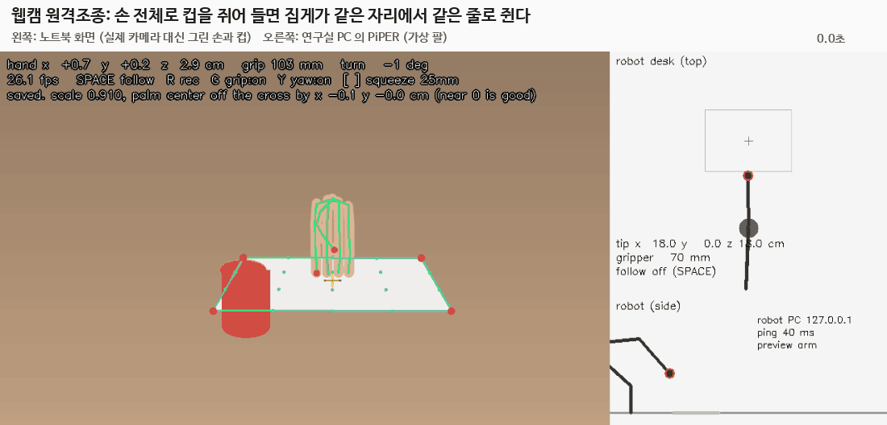

왼쪽은 노트북 화면이다. 실제 카메라 대신 그린 손과 컵으로 돌렸다. 오른쪽은 연구실 PC 쪽 PiPER(가상 팔)다. 손이 컵을 쥐고 들어 올리는 동안 집게 끝이 로봇 종이의 같은 자리·같은 높이로 가고, 집게가 닫힌다.

## 오늘 결과 한눈에

| 무엇을 봤나 | 결과 |
|---|---|
| 손을 종이 위에 펴서 올려놓아 MediaPipe 손 크기 맞추기 | 0.913 으로 맞춤 (참 0.909) |
| 손 전체로 쥔 손의 집기점 위치 (손 점 1 px 흔들림) | 평균 오차 0.2~0.3 cm |
| 같은 것, MediaPipe 손 3D 모양이 점마다 3 / 6 mm 틀릴 때 (11/16 검토) | 중간값 0.7 / 1.5 cm, 열에 아홉은 1.8 / 3.7 cm 안 |
| 집게가 닫히는 줄과 엄지·네 손가락 줄 | 쥐고 옮기는 동안 0°, 손을 크게 돌려도 반 바퀴 돌지 않음 |
| 역기구학 (A4 전체, 높이 1~15 cm) | 588곳 모두 5 mm 안 |
| 노트북 쪽 ↔ 연구실 PC 쪽 (같은 PC 안, 가상 팔) | 손 (14.8, 10.1, 12.0) cm → 집게 끝 (14.8, 10.1, 12.0) cm |
| mujoco 없이 numpy 로 한 운동학 | mujoco 와 차이 1e-15 m |
| GitHub 에서 이 폴더만 받아 새로 설치 (11/16 오후, 노트북 흉내) | MediaPipe 1.2.3·OpenCV 5.0 판과 0.10.21·4.11 판 모두 점검 통과, 계산 시험 24개 통과 |

노트북의 Claude 에 맡길 때는 [노트북_실행.md](../webcam_piper/노트북_실행.md) 링크를 주면 된다 (8절).

코드와 사용 설명서는 [11_실물_PiPER/webcam_piper](../webcam_piper/사용설명서.md) 에 있다.

## 1. 왜 만들었나

실물 PiPER 로 시범 데이터를 모아야 한다. 연구실에서는 찬혁님이 VR(Quest)로 조종해서 모으고 있다 (11/12 에 기록 형식을 살펴봤다). 장비가 없어도 모을 수 있으면 좋겠다고 생각하던 차에, 사용자가 예전에 만든 웹캠 로봇팔 조종(My_portfolio `2026/05`, SO-ARM101 + LeRobot)을 PiPER 용으로 바꿔 달라고 했다.

조건은 이랬다. 사람 앞과 로봇 앞에 같은 물체를 두고, 사람이 움직인 것과 로봇이 움직인 것이 똑같아야 한다.

원래 코드는 사람 팔의 관절 각도를 로봇 관절에 그대로 옮긴다. SO-ARM101 은 사람 팔과 비슷하게 생겨서 그게 된다. PiPER 는 팔 길이와 관절 배치가 사람과 달라서, 같은 각도를 주면 집게가 엉뚱한 곳에 간다. 사용자도 "사실상 그리퍼만 물체에 닿으면 되는 거잖아" 라고 해서, 관절 각도 대신 손 위치를 옮기기로 했다. 관절 각도는 프로그램이 역기구학으로 푼다.

## 2. 규칙: 같은 자리, 같은 거리

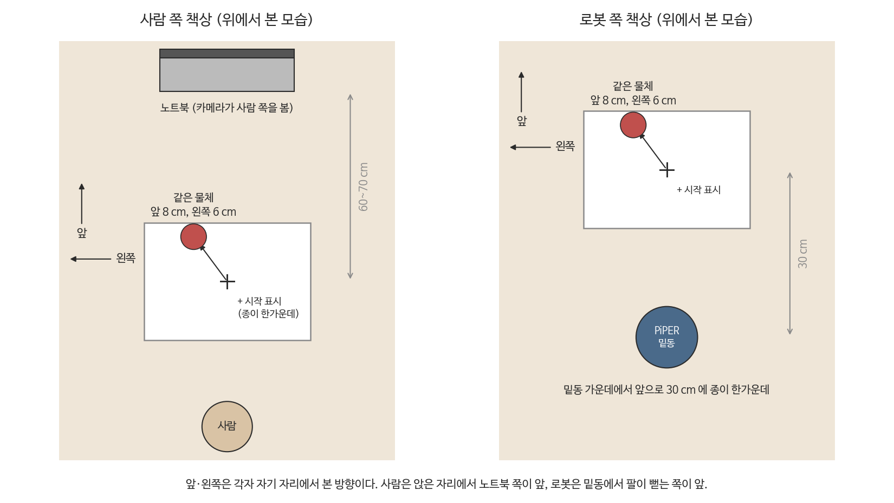

사람 책상과 로봇 책상에 A4 를 한 장씩 가로로 놓고 가운데에 + 를 그린다. 로봇 쪽 종이는 밑동에서 앞으로 30 cm 에 둔다. 사람 손이 사람 종이 + 에서 움직인 만큼 로봇 집게 끝도 로봇 종이 + 에서 똑같이 움직인다. 그래서 같은 물체를 두 종이의 같은 자리에 두면, 사람이 물체를 쥘 때 집게도 같은 물체를 쥔다.

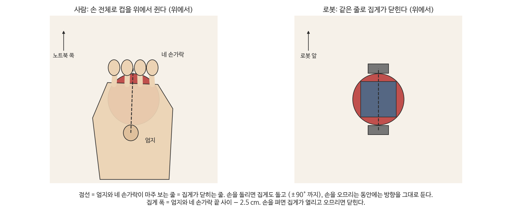

사람 손에서 무엇을 기준점으로 할지가 중요했다. 지금은 컵을 위에서 쥐듯이 손 전체로 쥔다. 기준점(집기점)은 엄지 끝과 네 손가락 끝 가운데의 가운데다.
- 집게 폭은 엄지와 네 손가락 끝 사이에서 25 mm 를 뺀 값이다.
- 엄지와 네 손가락이 마주 보는 줄이 집게가 닫히는 줄이 되도록 집게를 돌린다.
- 손을 오므리는 동안(사이가 5 cm 보다 좁을 때)에는 방향을 새로 읽지 않는다. 쥐는 순간에 손가락이 겹쳐 줄이 흔들려도 집게가 돌지 않게 하려는 것이다.

## 3. 카메라 화면의 손을 책상 좌표로

노트북 카메라는 책상 위에 그대로 둔다. 높일 곳이 없어서 낮은 자리에서 종이를 비스듬히 본다. 보정은 두 번이다.

첫째, 화면에서 종이 모서리 네 개를 누른다. 크기를 아는 직사각형이라서, 이것만으로 카메라 렌즈의 초점거리와 카메라가 종이를 어디서 보는지가 나온다. 시험에서 초점거리는 898 px 로 나왔다(참값 914). 카메라 위치 오차는 1.3 cm 였다.

| 모서리 누르기 | 확인 (파란 점이 종이 위에 고르게) |
|---|---|
| 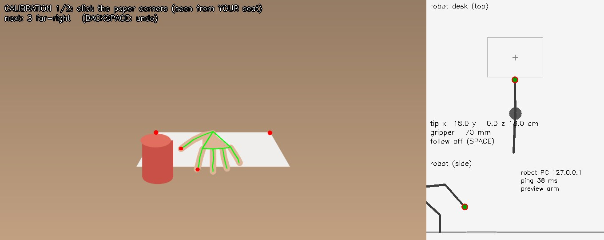 | 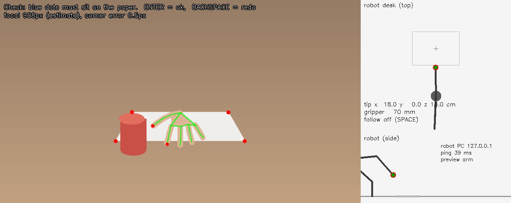 |

둘째, 손 크기를 맞춘다. MediaPipe Hands 는 손 21점의 화면 위치와 손 기준 3D 좌표를 함께 준다. 두 가지를 맞추면(PnP) 카메라에서 손까지의 거리가 나온다. 다만 MediaPipe 는 평균 손 크기를 가정하므로 사람마다 거리가 몇 % 틀린다.
- 그래서 손을 종이 위에 쫙 펴서 올려놓고 한 번 잰다.
- 이때 21점은 모두 종이 바로 위에 있다. 손가락 끝은 0.6 cm, 뿌리는 1.3 cm, 손목은 1.8 cm 안팎으로, 살 두께의 절반쯤이다.
- 이 높이에 가장 잘 맞는 거리 배율을 고른다.

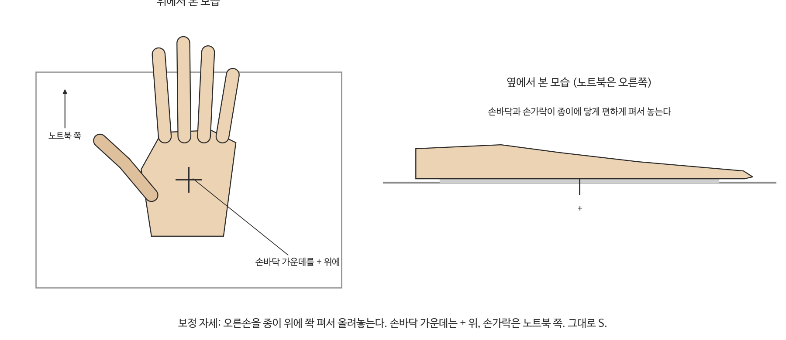

| 보정 2/2 화면 (왼쪽 아래에 자세 그림이 뜬다) | 보정이 끝난 화면 |
|---|---|
| 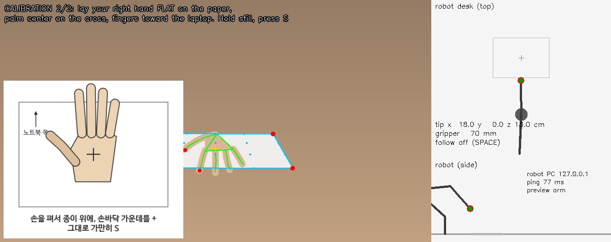 | 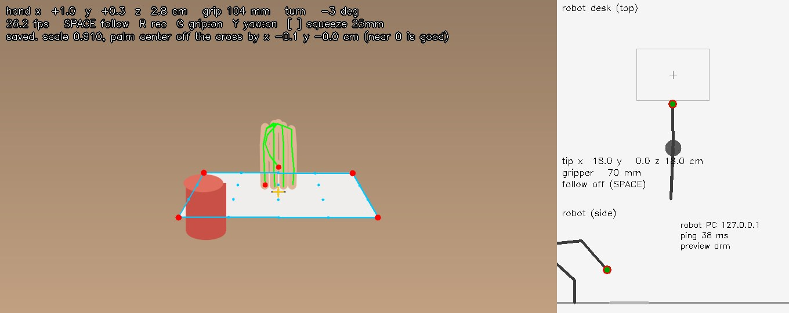 |

그린 손으로 잰 결과는 다음과 같다. 가상 카메라는 1280×720, 시야 70°, 책상 위 25 cm 에 두었고, MediaPipe 가 손 크기를 10% 크게 안다고 가정했다.

| 조건 | 손 크기 배율 (참 0.909) | 손바닥 가운데 위치 오차 |
|---|---|---|
| 손 점 1 px 흔들림 | 0.913 | 0.2 cm |
| 손 점 3 px 흔들림 | 0.920 | 0.5 cm |
| 실제 손 두께가 어림보다 3 mm 두꺼움 / 얇음 | 0.924 / 0.902 | 0.9 / 0.6 cm |

| 손 전체로 쥔 손 (30번씩) | 집기점 평균 오차 | 흔들림 | 집게 방향 |
|---|---|---|---|
| 손 점 1 px 흔들림 | 0.2~0.3 cm | 0.1~0.3 cm | 0° ± 0 |
| 손 점 3 px 흔들림 | 0.1~0.3 cm | 0.6~1.2 cm | 0° ± 1 |

손 두께 어림값이 3 mm 틀리면 위치가 1 cm 안쪽으로 틀린다. 이 값들은 실제 손으로 잰 것이 아니어서 실제 카메라에서 다시 봐야 한다.

## 4. 관절 계산: 위치 먼저, 방향은 남는 만큼

처음에는 집게 끝 위치와 방향(똑바로 아래)을 같은 무게로 풀었다. 이렇게 하면 A4 범위 588곳 중 408곳에서만 답이 나왔다. 밑동 가까이나 높은 곳에서는 집게를 똑바로 세운 채로는 닿지 않기 때문이다.

그래서 위치를 먼저 맞추고, 남는 자유도로만 방향을 맞추게 바꿨다. 관절 한계에 닿은 관절은 그 반복에서 빼고 다시 푼다. 이렇게 하니 588곳 모두 5 mm 안에 닿았다.

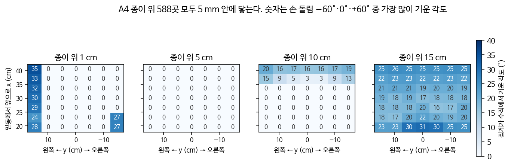

숫자는 손을 −60°·0°·+60° 돌렸을 때 가운데 가장 많이 기운 각도다.
- 종이 위 5 cm 에서는 49곳 모두 집게가 똑바로 선다(0°).
- 1 cm 에서는 로봇 왼쪽 끝 줄과 오른쪽 가까운 두 곳만 24~35° 기운다.
- 10 cm 의 먼 쪽 두 줄과 15 cm 에서는 3~31° 기운다.

물체를 쥐는 높이(1~5 cm)에서는 종이 왼쪽 끝을 빼면 똑바로 서니 대부분의 물체는 괜찮을 것이다. 왼쪽 끝에 놓인 물체를 손을 크게 돌려 쥐면 집게가 기울 수 있다. 이것은 실물로 확인해야 한다.

집게 방향에는 제약이 하나 더 있다. 6번 관절은 ±120° 까지만 돈다. 집게는 앞뒤가 같아서 180° 마다 같은 모양이다. 처음에는 가까운 쪽을 고르고 끝에 닿으면 반 바퀴 반대쪽으로 넘어가게 했는데, 손을 오른쪽 45° 에서 왼쪽 110° 로 천천히 돌리는 시험에서 한 번씩 반 바퀴를 돌았다. 물체를 든 채 집게가 휙 도는 것은 위험해서 이렇게 바꿨다.
- 따라가기를 켤 때는 오른손이 잘 도는 쪽을 고른다.
- 그다음부터는 바로 전 방향에 가까운 쪽을 고른다.
- 돌릴 수 있는 끝에 닿으면 거기서 멈춘다.

| 손 돌림 훑기 (오른쪽 45° → 왼쪽 110°) | 반 바퀴 돎 | 닫히는 줄 차이 (중간값 / 최대) |
|---|---|---|
| 처음 방식 (넘어감) | 세 자리 모두 1번 | 0° / 89° |
| 지금 방식 (끝에서 멈춤) | 0번 | 0° / 23~41° (오른쪽 끝에서만) |

## 5. 노트북과 연구실 PC 를 나눴다

PiPER 는 연구실 PC 에 CAN 으로 붙어 있고, 카메라는 사용자 노트북에 있다. 사용자가 "노트북 카메라만 불러와서 못 하나" 라고 물어서 둘로 나눴다. 노트북은 사진을 보내지 않고 숫자 다섯 개(집기점 x, y, z, 집게 방향, 손가락 사이)만 UDP 로 초당 15~30번 보낸다. 한 번에 170바이트쯤이라 와이파이로 충분하다.

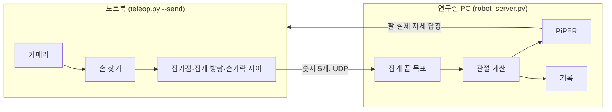

연구실 PC 는 팔의 실제 자세를 답장으로 보내고, 노트북 화면 오른쪽에 그대로 그린다.

| 연결된 노트북 화면 (따라가기·기록 중) | 연결이 안 됐을 때 |
|---|---|
| 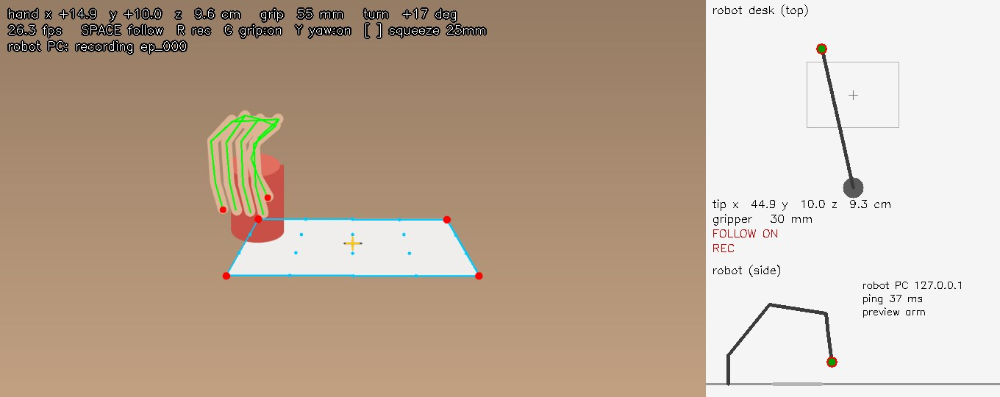 | 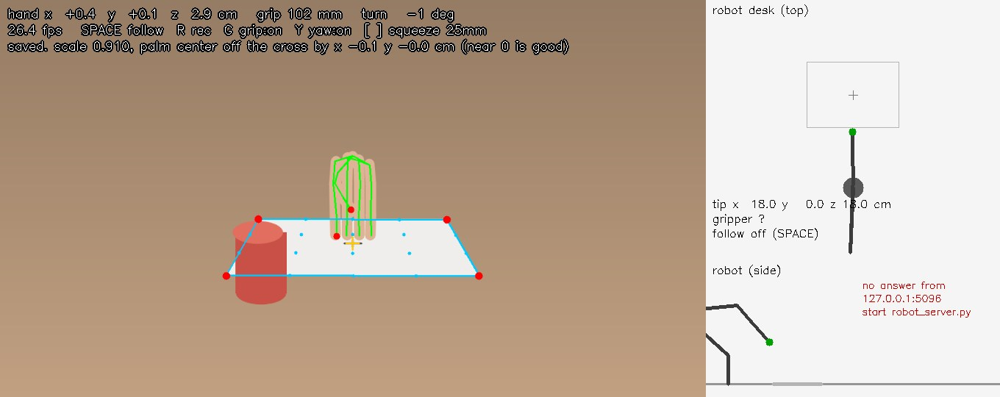 |

안전장치는 연구실 PC 쪽에 두었다. 가짜 노트북으로 하나씩 확인했다.

| 상황 | 연구실 PC 가 하는 일 | 확인 |
|---|---|---|
| 노트북에서 따라가기가 켜진 채로 연결 | 움직이지 않음. SPACE 를 다시 눌러야 움직임 | 됨 |
| 신호가 0.5초 넘게 끊김 | 그 자리에 멈추고 따라가기를 끔. 신호가 돌아와도 SPACE 전에는 안 움직임 | 1초 끊김에서 0.5초에 멈춤 |
| 다른 컴퓨터가 신호를 보냄 | 처음 연결한 노트북이 3초 넘게 조용할 때까지 무시 | 됨 |
| 노트북이 꺼짐 | 팔을 멈추고 기록을 저장 | 됨 |

연구실 PC 에서는 찬혁님 piper-teleop 가상환경(agx-bus 가 깔린 것)으로 돌린다. 그런데 여기에 mujoco 가 없었다. 로봇 계산에 mujoco 를 쓰고 있었는데, 계산 자체는 관절 6개의 회전을 차례로 곱하는 것이라 numpy 로 다시 썼다. 2000개 자세에서 mujoco 와 위치·방향·자코비안 차이가 1e-15 였다. 역기구학도 588곳 모두 그대로 닿았다. 덕분에 노트북에도 mujoco 를 깔 필요가 없어졌다.

## 6. 시작 자세를 세 번 바꿨다

| | 처음 (11/15 저녁) | 두 번째 (11/16 0시) | 지금 (11/16) |
|---|---|---|---|
| 보정 자세 | 손바닥 아래, 손가락 앞, 엄지와 검지 끝을 종이 + 에 댐 | + 위의 쌀알을 엄지·검지로 집는 시늉 | 손을 종이 위에 쫙 펴서 올려놓음, 손바닥 가운데를 + 에 |
| 쥐는 손 | 엄지 ↔ 검지 | 엄지 ↔ 검지 | 엄지 ↔ 네 손가락 (손 전체) |
| 손 크기 맞추는 단서 | 집기점 한 점이 종이 위 1.2 cm | 같음 | 손 21점이 모두 종이 바로 위 |
| 바꾼 까닭 | | 사용자: "누구나 보고 쉽게 이해할 수 있는 동작으로" | 사용자: "손가락 전체를 사용하는 게 더 편할 것 같은데" |

처음 자세는 설명이 길었다. 손바닥 방향, 손가락 방향, 어느 손가락 끝을 어디에 댈지를 다 맞춰야 했다. 두 번째는 누구나 아는 동작이었지만, 사용자는 손가락 전체를 쓰는 편이 더 편하겠다고 했다.

지금은 손을 펴서 종이 위에 올려놓기만 하면 된다. 21점이 모두 종이에 붙어 있어서 손 크기를 맞추는 단서도 한 점에서 21점으로 늘었다. 작은 물체를 엄지·검지로 집는 방식은 `--grip pinch` 로 남겨 두었다.

## 7. 검토 (11/16)

다 만든 뒤 사용자가 검증 검토를 부탁해서, 코드를 처음부터 다시 읽고 더 거친 조건으로 시험했다.

| 본 것 | 어떻게 | 결과 | 한 일 |
|---|---|---|---|
| 실물 팔 명령이 agx-bus 에 있는가 | 설치된 agx-bus 0.4.0 의 함수 이름·인자와 대조 | 모두 맞음 | 없음 |
| piper_sdk 길 | 같은 방법 | 이 PC 에 piper_sdk 가 없어 못 봄 | 설명서에 "실물은 agxbus 로" 적음 |
| 손을 다시 찾은 첫 장면이 엉뚱할 때 | x 40 cm 한 장 뒤 3초 동안 참 x 0 | 3초 뒤에도 40 cm 에 묶여 있음 (버그). 따라가기 중이면 팔이 그쪽으로 감 | 고침: 새로 잡을 때 3장이 3 cm 안에서 맞아야 받음. 엉뚱한 값 0장, 3장째부터 바른 값 |
| MediaPipe 손 3D 모양 오차 | 21점마다 3·6·10 mm 흔들림을 넣음 | 집기점 중간값 0.7 / 1.5 / 2.8 cm (아래 표) | 설명서·일지 수치에 함께 적음 |
| 손 3D 가 화면과 거울상이면 | z 를 뒤집어 넣음 | 집게 방향 30° 쯤, 위치 3 cm 틀어짐. 맞춘 정도(다시 투영 오차)로는 거의 구별이 안 됨 | 고침: 손을 펴서 올려놓은 21점이 종이 높이에 더 잘 맞는 쪽을 20장 다수결로 고름. 120번 중 119번 맞음 |
| 화면 점 광선 + 모델 깊이로 손끝 구하기 | 모양 오차 시험을 두 방식으로 | 위치는 거의 같음 (오차는 대부분 깊이에서 옴). 방향만 조금 나음 (6 mm 에서 열에 아홉 7° → 4°) | 바꾸지 않음 |
| 설명서의 "오른쪽으로 15° 넘게 돌리면 멈춤" | 6번 관절 끝을 자리별로 계산 | 틀림. 가운데 22°, 로봇 오른쪽 끝 48°, 왼쪽 끝은 거의 못 돌림 | 설명서 고침 |

| MediaPipe 손 3D 가 점마다 틀린 정도 | 손 크기 배율 (참 0.909) | 집기점 중간값 | 열에 아홉 | 집게 방향 중간값 / 열에 아홉 |
|---|---|---|---|---|
| 0 mm | 0.912 | 0.3 cm | 0.8 cm | 0° / 1° |
| 3 mm | 0.899 | 0.7 cm | 1.8 cm | 1° / 4° |
| 6 mm | 0.867 | 1.5 cm | 3.7 cm | 3° / 9° |
| 10 mm | 0.801 | 2.8 cm | 6.5 cm | 5° / 16° |

진짜 MediaPipe 손 3D 가 얼마나 틀리는지는 아직 모른다. 그래서 실제 정확도는 이 표의 어느 줄일지 노트북으로 재 봐야 안다. 오차의 대부분은 카메라에서 손까지의 거리에서 온다. 카메라를 높이 두어 내려다보게 하면 거리 오차가 책상 위 위치에 덜 옮겨 갈 것이다. 이것은 가설이고, 재 봐야 한다.

거울상 판별과 엉뚱한 첫 장면 처리는 `test_geometry.py` 6~8번으로 남겨 두어, 다음에도 같은 시험을 돌릴 수 있다. 화면 전체 흐름, 노트북 ↔ 연구실 PC, 안전장치 시험도 고친 뒤 다시 돌려 모두 같은 결과가 나왔다.

## 8. 노트북 Claude 에 맡기기 (11/16 오후)

사용자가 노트북에서 Claude 에 GitHub 링크만 보여 주고 설치부터 시키겠다고 해서, 노트북 Claude 가 그대로 따라 할 글과 혼자 확인할 수 있는 도구를 만들었다.

| 만든 것 | 하는 일 |
|---|---|
| [노트북_실행.md](../webcam_piper/노트북_실행.md) | 받기 → 설치 → 점검 → 노트북 혼자 해 보기 → 연구실 PC 와 잇기 → 결과 정리. Claude 가 할 일과 사용자가 할 일을 나눔. 키는 사용자만 누르고, 연구실 PC 주소는 파일에 적지 않음 |
| `check_setup.py` | 프로그램·손 모델·계산 시험·웹캠을 보고 `점검: 모두 됨` 을 냄. 웹캠 사진을 한 장 남겨 종이가 잘 보이는지 Claude 가 볼 수 있음. `--robot-pc` 는 따라가기를 켜지 않고 주고받기만, `--report` 는 보정 값과 P 결과를 연구실에 붙여 넣을 한 덩어리로 |
| P 키 | 다섯 손가락 끝을 모아 종이 모서리나 + 에 대고 누르면 가장 가까운 점과 몇 cm 다른지 남김. 지금까지는 사람이 화면 숫자를 읽어야 했음 |
| `test_geometry.py` 끝 줄 | `결과: 모두 통과 (24개)` 처럼 통과·실패를 말함. 전에는 숫자만 나와서 무엇이 정상인지 사람이 알아야 했음 |

GitHub 에서 이 폴더만 새로 받아(4 MB, 저장소 전체는 1 GB 넘음) 새 가상환경에 깔아 보니, 그 사이 MediaPipe 는 1.2.3, OpenCV 는 5.0 으로 판이 크게 올라 있었다. 그대로 깔리는 최신 판과, 인텔 맥에서 깔리게 될 옛 판(MediaPipe 0.10.21, OpenCV 4.11) 둘 다 시험했다. 둘 다 점검과 계산 시험을 통과했고 숫자도 연구실 PC 와 같았다. 구글 예시 손 사진에서 두 판 모두 손 21점을 같은 값으로 찾았다.

같은 사진으로 MediaPipe 가 어느 손을 'Left' 라 부르는지 보았다. 문서에는 거울(셀카) 사진을 가정한다고 되어 있다. 그 말대로라면 뒤집지 않은 사진에서 왼손은 'Right' 로 나와야 한다. 그런데 손바닥이 보이는 손은 사진에서 왼손 모양인데 'Left' 로 나왔다. 다른 손은 손등인지 손바닥인지 사진만으로 확실하지 않았다. 그래서 어느 쪽이 맞다고 정하지 않았다. 대신 보정 때 손 하나만 보일 때 실제로 나온 이름을 재서 `calib.json` 에 두고, 두 손이 다 보이면 그 이름인 손을 따라가게 바꿨다. 전에는 오른손이 'Left' 로 나온다고 가정했는데, 이 가정이 틀리면 두 손이 보일 때 엉뚱한 손을 따라갈 수 있었다. 실물 팔이면 위험한 일이다.

윈도우 Git Bash 는 `/` 로 시작하는 인자를 윈도우 경로로 바꿀 수 있다 (윈도우에서 직접 해 보지는 않았다). 그래서 받는 명령의 폴더 이름은 `/` 없이 `11_*/webcam_piper/` 로 썼다. 이 PC 에서 두 방식이 같은 폴더를 받는 것을 확인했다. git 이 없을 때 Python 만으로 받는 방법도 넣고 시험했다.

## 막힌 것과 해결

| 문제 | 원인 | 해결 |
|---|---|---|
| 방향까지 맞추게 하면 A4 범위 588곳 중 408곳만 닿음 | 밑동 가까이·높은 곳은 집게를 세운 채 닿지 않음 | 위치 먼저, 방향은 남는 자유도로. 관절 한계에 닿은 관절은 빼고 다시 풂 |
| 연구실 가상환경에서 로봇 계산이 안 돎 | agx-bus 환경(Python 3.14)에 mujoco 없음 | numpy 로 다시 씀 (mujoco 와 1e-15 차) |
| 손을 크게 돌리면 집게가 반 바퀴 돎 | 6번 관절 ±120° 끝에서 반대쪽으로 넘어가게 했음 | 끝에서 멈추게 함, 켤 때 오른손이 잘 도는 쪽을 고름 |
| 설명서의 `[` `]` 키 설명이 반대 | 코드를 보지 않고 썼음 | 코드를 읽고 고침 (`[` 약하게, `]` 세게) |
| 맥에서 Backspace 가 안 먹힘 | 맥의 지우기 키는 127 | 8 과 127 을 둘 다 받음 |
| 설명서 화면 그림이 한 장에 690 KB | 그린 카메라 화면에 넣은 잡음이 PNG 압축을 막음 | JPEG 로 바꿈, GIF 는 잡음 없이 그림 |
| 손을 다시 찾은 첫 장면이 엉뚱하면 그 값에 묶임 (검토에서 찾음) | 15 cm 넘게 튀는 값을 버리기만 하고, 첫 값은 확인하지 않았음 | 새로 잡을 때 3장이 맞아야 받음, 정말 옮겨 갔으면 5장 뒤 다시 잡음 |
| 손 3D 가 거울상이면 방향이 30° 틀어짐 (검토에서 찾음) | MediaPipe 손 3D 의 좌우 방향을 확인하지 않았음 | 보정 때 펴서 올려놓은 21점으로 다수결 판별, calib.json 에 저장 |
| 두 손이 보이면 어느 손을 따라갈지가 가정에 걸려 있었음 (11/16 오후) | MediaPipe 'Left'·'Right' 표시가 문서 말대로인지 예시 사진으로 확인되지 않음 | 보정 때 실제 표시를 재서 씀 |
| 노트북에 깔릴 판이 연구실에서 시험한 것과 다름 | MediaPipe 1.x, OpenCV 5.0 이 새로 나옴 | 새 가상환경에서 새 판과 옛 판 둘 다 시험 |

## 측정한 수치

| 항목 | 값 | 조건 |
|---|---|---|
| 손 크기 배율 | 0.913 (참 0.909) | 손 펴서 올려놓기, 손 점 1 px 흔들림, 그린 손 |
| 집기점 평균 오차 | 0.2~0.3 cm | 손 전체로 쥔 손, 손 점 1 px, 다섯 자리 |
| 역기구학 범위 | 588/588 (5 mm 안) | A4 전체 7×7, 높이 1·5·10·15 cm, 돌림 −60·0·+60° |
| 노트북 → 연구실 PC 신호 간격 | 최대 34 ms | 같은 PC 안 |
| 집게 방향 반 바퀴 돎 | 0번 | 손 돌림 훑기 세 자리 |
| 집기점 중간값 (손 3D 모양 3 mm 오차) | 0.7 cm | 11/16 검토, 그린 손 다섯 자리 × 40번 |
| 거울상 판별 | 119/120 | 보정 20장 다수결, 모양 오차 3·6 mm |
| 이 폴더만 받는 크기 | 3.6 MB (저장소 전체 .git 1.6 GB) | git sparse checkout |
| `check_setup.py` 점검 (웹캠 빼고) | 9초 | Python 3.12, MediaPipe 1.2.3 |
| 연구실 PC 주고받기만 | 답장까지 가운데 34 ms | 같은 PC 안, `check_setup.py --robot-pc` |

## 새로 나온 말

- 집기점: 사람 엄지 끝과 네 손가락 끝 가운데 사이의 가운데. 로봇 집게 끝과 짝을 맞추는 점이다.
- MediaPipe Hands: 사진 한 장에서 손 21점의 화면 위치와 손 기준 3D 좌표를 내는 Google 의 손 찾기 모델.
- PnP (Perspective-n-Point): 모양을 아는 점들이 화면 어디에 찍혔는지로 카메라와 그 물체 사이의 위치·방향을 구하는 계산. 종이 모서리와 손 21점에 썼다.
- UDP: 받았는지 확인하지 않고 짧은 메시지를 바로 보내는 통신 방식. 늦게 온 값보다 새 값이 중요한 원격조종에 맞다.
- 1€ 필터: 멈춰 있을 때는 강하게, 빨리 움직일 때는 약하게 떨림을 거르는 필터. 원래 웹캠 조종 코드에서 그대로 가져왔다.

## 지금 가장 잘 되는 시뮬 장면

시뮬레이션 쪽 가장 높은 설정(w12m + 다듬기)은 11/4 와 같다. 성공 장면은 그대로 둔다.

## 다음에 할 것

- [ ] 사용자 노트북에서 노트북 Claude 가 `노트북_실행.md` 대로 설치·보정하고, + 와 네 모서리에서 P 를 눌러 오차를 잰다. `check_setup.py --report` 결과를 받아 검토 표의 어느 줄에 가까운지 본다
- [ ] 같은 결과에서 손 3D 거울상 판별(`ok` / `MIRRORED`)과 MediaPipe 가 오른손을 부르는 이름이 어느 쪽인지 본다
- [ ] 손을 펴서 올려놓은 자세의 실제 21점 높이가 어림값과 맞는지 본다
- [ ] 실제 손으로 컵을 쥘 때 엄지와 네 손가락 끝 사이가 컵보다 얼마나 넓게 나오는지 재서 25 mm 를 고친다
- [ ] 노트북과 연구실 PC 를 실제 와이파이로 연결한다 (같은 망이 아니면 Tailscale)
- [ ] 연구실에서 사람이 옆에 있을 때 실물 PiPER 로 `--speed 20` 부터. 그리퍼가 명령에 반응하는지 다시 본다 (11/12 에는 반응 없음)
- [ ] 모은 기록을 찬혁님 zarr 형식으로 바꾸는 변환기
